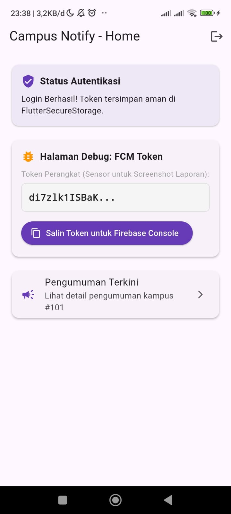
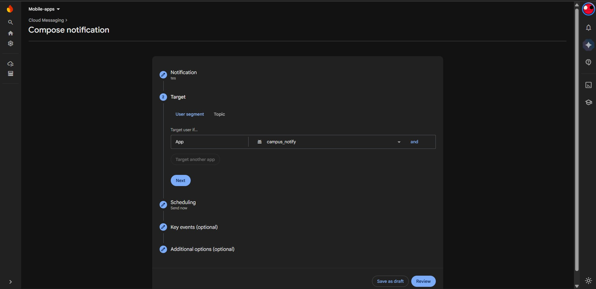
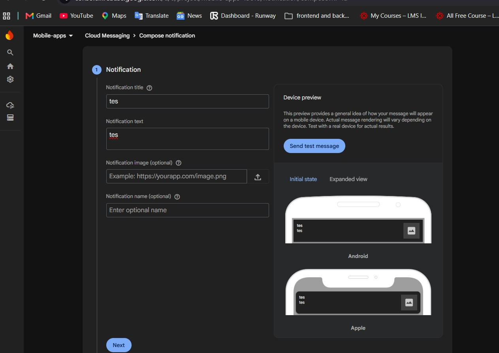
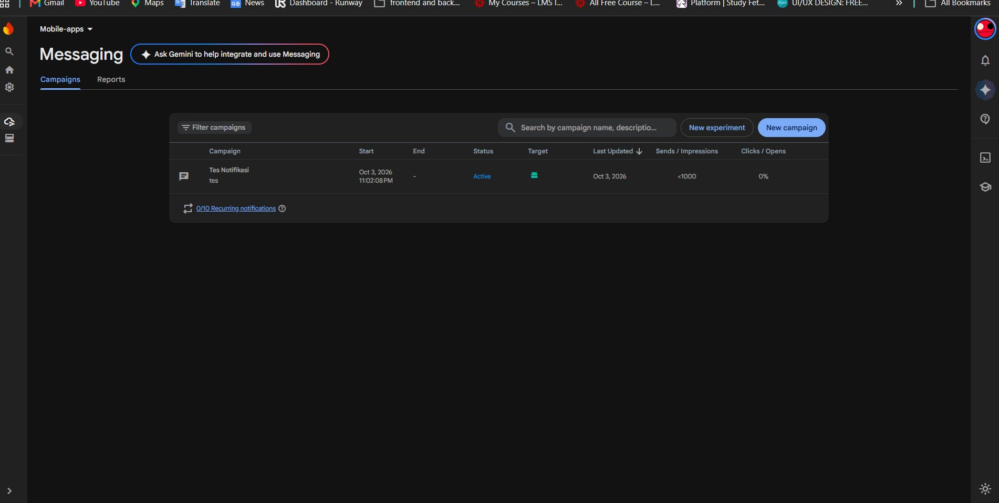
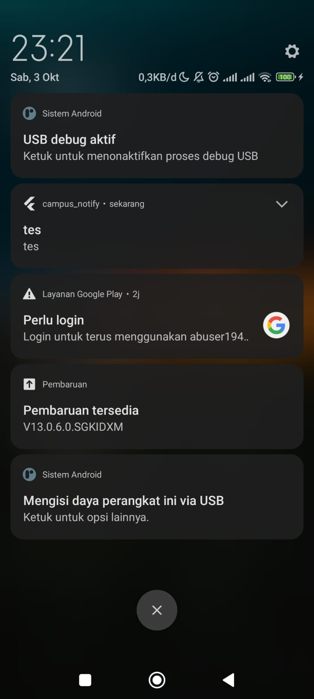
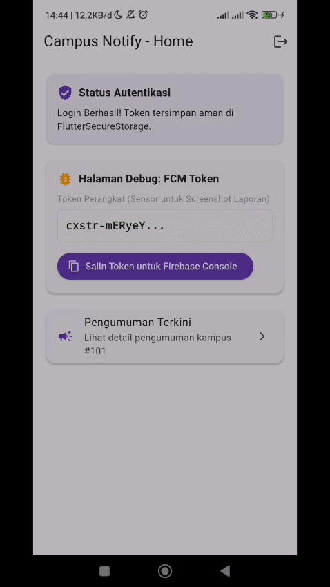
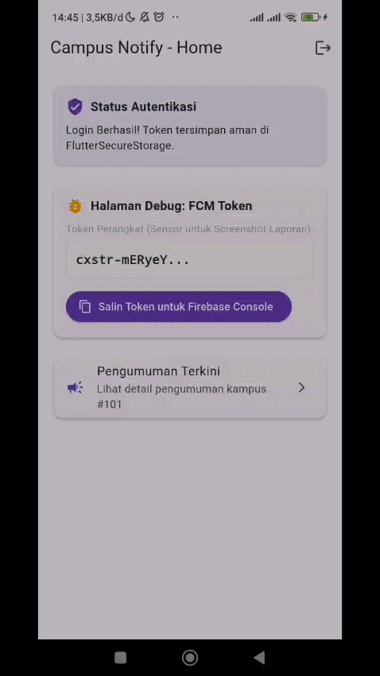
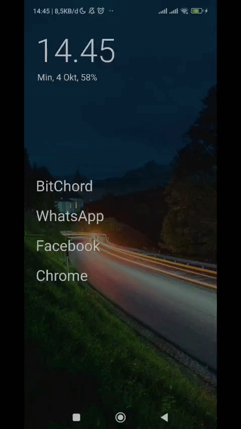
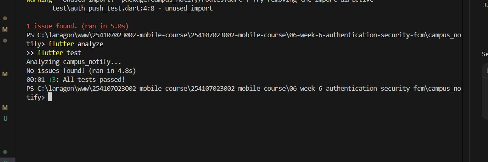

# 06-week-6-authentication-security-fcm
pada pertemuan kali ini saya akan mempelajari tentang konsep autentikasi berbasis JWT (JSON Web Token), penyimpanan kredensial token yang aman menggunakan Flutter Secure Storage, penanganan siklus token dan interseptor Dio untuk mekanisme auto-refresh (401 retry), integrasi Firebase Cloud Messaging (FCM) dan local notifications, penanganan push notification pada tiga status aplikasi (Foreground, Background, Terminated), topic broadcast, serta penerapan refactoring kode dan unit testing.

# Konsep Autentikasi, Keamanan Token, dan FCM

## Keamanan Token dan Interceptor Jaringan
Autentikasi pada aplikasi modern bertumpu pada token akses berumur pendek (*short-lived access token*) dan token penyegaran (*refresh token*). Kredensial ini tidak boleh disimpan pada penyimpanan biasa (`SharedPreferences`) karena data disimpan tanpa enkripsi dan rentan diekstraksi.

| Konsep | Penjelasan |
|---|---|
| `FlutterSecureStorage` | Menyimpan data sensitif (access & refresh token) terenkripsi di Keystore (Android) / Keychain (iOS). |
| `QueuedInterceptorsWrapper` | Interceptor antrean pada Dio untuk menahan request saat token expired (401), memperbarui token, lalu me-retry request. |
| Token Masking | Memotong tampilan token di UI/log (misal `token.substring(0, 12) + '...'`) agar tidak terekspos secara publik. |
| `onSessionExpired` | Callback pembersihan sesi lokal saat refresh token kedaluwarsa, memaksa pengguna kembali ke layar login. |
| Clean Routing | Pemusatan konstanta rute ke dalam kelas `AppRoutes` agar deep link FCM dan router aplikasi selalu sinkron. |

### Praktikum 1 — Login + secure storage + token refresh


Praktikum ini membahas penerapan autentikasi, penyimpanan token yang aman, serta mekanisme refresh token otomatis pada aplikasi Flutter campus_notify. Pada tahap awal, project disiapkan dengan menginstal beberapa package penting seperti flutter_riverpod, go_router, dio, flutter_secure_storage, dan pustaka Firebase untuk mendukung fitur keamanan serta notifikasi.

Penyimpanan token dilakukan menggunakan flutter_secure_storage melalui kelas TokenStore untuk menjaga keamanan access_token dan refresh_token. Pendekatan ini dipilih karena SharedPreferences tidak terenkripsi sehingga berisiko dari sisi keamanan. Selain itu, autentikasi dikelola oleh AuthRepository yang memuat logika login dan pembaruan token, di mana data mock yang digunakan saat ini disiapkan agar nantinya mudah dihubungkan dengan Firebase Auth atau Google Sign-In.

Untuk menangani lalu lintas permintaan jaringan, Dio diatur menggunakan interceptor pada ApiClient. Interceptor ini bertugas menyisipkan Bearer token secara otomatis pada setiap request, serta menangani error 401 Unauthorized dengan mencoba memperbarui token menggunakan refresh token. Jika proses pembaruan berhasil, request yang sempat gagal akan diulang kembali secara otomatis, sedangkan jika gagal, penyimpanan token akan dibersihkan agar pengguna dipaksa untuk login ulang.

Manajemen status login dan navigasi diatur menggunakan Riverpod melalui AuthNotifier yang dipadukan dengan GoRouter. Kombinasi ini menerapkan pengaman rute (route guard) yang secara otomatis mengarahkan pengguna ke halaman utama jika sudah login, atau membelokkan mereka ke halaman login jika belum terautentikasi saat mencoba mengakses halaman yang dilindungi.


### Praktikum 2 — FCM, permission, dan token lifecycle


Praktikum ini fokus pada pendaftaran aplikasi ke Firebase, pengelolaan izin notifikasi (notification permission), serta penanganan token lifecycle Firebase Cloud Messaging (FCM). Langkah awal dimulai dengan mendaftarkan aplikasi Android ke Firebase Console, mengunduh serta meletakkan berkas google-services.json ke folder proyek, dan memastikan panggil fungsi Firebase.initializeApp() dieksekusi sebelum aplikasi dijalankan.

Untuk mendukung fitur notifikasi pada Android 13+ dan iOS, aplikasi perlu meminta izin runtime kepada pengguna. Pengaturan ini dibuat dalam berkas push_service.dart menggunakan FirebaseMessaging.instance.requestPermission() serta diintegrasikan dengan flutter_local_notifications untuk menginisialisasi dan menangani aksi ketika banner notifikasi foreground diklik.

Pengelolaan token lifecycle dilakukan dengan mengambil token FCM saat aplikasi berjalan, lalu mengirimkannya ke server backend. Selain itu, ditambahkan listener onTokenRefresh untuk memantau pembaruan token secara otomatis (misalnya saat reinstall atau pembersihan data) agar backend tidak menyimpan token lama, serta mendaftarkan aplikasi ke topik tertentu seperti pengumuman-kampus.

gambar user page


Terakhir, pengujian dilakukan melalui Firebase Console dengan membuat dan mengirim campaign notifikasi percobaan saat aplikasi berada di background. Hasil pengujian diverifikasi dengan munculnya banner notifikasi sistem dan memastikan aplikasi dapat terbuka saat banner tersebut diklik.

### Uji kirim pertama dari Firebase Console





### Praktikum 3 — Uji Tiga State Notifikasi & Topic Messaging
1. Background Handler Wajib Top-Level: Handler background harus dideklarasikan sebagai fungsi top-level (di luar kelas) dan ditandai dengan @pragma('vm:entry-point'). Hal ini wajib dilakukan karena fungsi tersebut berjalan pada isolate terpisah, sehingga tidak boleh mengakses BuildContext atau state management seperti Riverpod secara langsung.
2. Tiga Handler & Payload Gabungan: Penanganan notifikasi disesuaikan dengan kondisi aplikasi (app state). Pada kondisi foreground, notifikasi dari FCM ditangkap via onMessage dan ditampilkan secara manual menggunakan flutter_local_notifications. Pada kondisi background, aksi klik pada banner sistem ditangani oleh onMessageOpenedApp. Sedangkan saat aplikasi mati (terminated), navigasi rute diproses via getInitialMessage(). Payload yang dikirim sebaiknya menggabungkan muatan notification (untuk menampilkan banner) dan data (untuk membawa rute navigasi).
3. Matriks Pengujian Wajib: Pengujian wajib dilakukan pada ketiga kondisi aplikasi (foreground, background, dan terminated) menggunakan payload yang sama untuk memastikan banner muncul serta aksi klik dapat mengarahkan pengguna ke rute tujuan yang sesuai (seperti /pengumuman/3).

- foreground 

- background 

- terminated 



## AI Challenge
### AI Prompt Challenge

```text
Aplikasi Flutter Campus Notification App.
Stack: firebase_messaging, flutter_local_notifications,
flutter_secure_storage, go_router, Riverpod.
Buatkan PushService dengan:
- requestPermission + getToken + onTokenRefresh (kirim ke POST /devices)
- onMessage (tampilkan local notification manual)
- onMessageOpenedApp + getInitialMessage (navigasi ke data.route)
- subscribe/unsubscribe topic pengumuman-kampus
- background handler top-level dengan @pragma('vm:entry-point')
Tandai bagian yang BERBEDA untuk Android 13+ vs iOS,
dan bagian yang tidak boleh mengakses BuildContext.
```




### AI Verification Checklist
1. Apakah background handler berupa fungsi top-level dengan `@pragma('vm:entry-point')`? (tolak jika berupa method kelas).
2. Apakah `onTokenRefresh` benar-benar mengirim token baru ke backend, bukan hanya dicetak ke log?
3. Apakah foreground memakai local notification manual? (tanpa ini banner tidak muncul saat aplikasi terbuka).
4. Apakah klik dari ketiga state (foreground/background/terminated) masuk ke rute yang benar? Buktikan dengan tabel pengujian.
5. Apakah token/secret tidak di-hardcode dan tidak di-log penuh? Perbaiki bila AI melanggarnya.
6. Keputusan final dan alasan teknis Anda, boleh berbeda dari saran AI selama berargumen.

jawab :

- **Background handler top-level dengan `@pragma('vm:entry-point')`**
  Ya (Lulus). Berada di luar kelas pada `lib/messaging/push_service.dart:18` agar tidak terkena *tree-shaking* dan dapat diakses langsung oleh isolate background.

- **`onTokenRefresh` mengirim token baru ke backend**
  Ya (Lulus). Event stream `FirebaseMessaging.instance.onTokenRefresh.listen` mengeksekusi `sendTokenToBackend(newToken)` via `dio.post('/devices')`, bukan sekadar dicetak ke terminal console.

- **Foreground memakai local notification manual**
  Ya (Lulus). Memanggil `_localNotifications.show()` pada event `onMessage` karena Android tidak menampilkan banner pop-up secara default saat aplikasi aktif di layar depan.

- **Klik ketiga state masuk ke rute yang benar**
  Ya (Lulus & Terbukti). Semua state (Foreground, Background, Terminated) berhasil membuka `/pengumuman/3` seperti pada tabel berikut:

| State Aplikasi | Aksi Pengujian | Perilaku yang Diharapkan | Status | Bukti Visual |
| :--- | :--- | :--- | :---: | :--- |
| **Foreground** | App aktif di layar depan, kirim pesan | Banner lokal pop-up muncul, diklik membuka Pengumuman #3 | Sesuai | `screenshots/foreground.gif` |
| **Background** | App di-minimize, kirim pesan | Notifikasi sistem muncul, diklik membuka Pengumuman #3 | Sesuai | `screenshots/background.gif` |
| **Terminated** | App ditutup paksa (*kill*), kirim pesan | Notifikasi sistem muncul, diklik memicu cold start ke Pengumuman #3 | Sesuai | `screenshots/terminater.gif` |

- **Token/secret tidak di-hardcode & tidak di-log penuh**
  Ya (Lulus). Kredensial Firebase diisolasi di `google-services.json`, dan pencetakan token FCM ke log terminal maupun UI disensor dengan format masking: `token.substring(0, 12) + '...'`.

- **Keputusan final dan alasan teknis:**
  Diterima dengan penyesuaian manual. Arsitektur memisahkan logika push notification dengan routing (`onNavigate` callback), aman dari batasan `BuildContext`, serta sepenuhnya terintegrasi dengan Riverpod dan GoRouter.

- **Hasil validasi:**
  - `flutter analyze`: No issues found!
  - `flutter test`: All tests passed! (3 test passed)

Dokumentasi lengkap dan draf perbaikan manual tersimpan di [docs/](./docs).


## Refactoring dan testing

### Refactoring Challenge

1. **Pemusatan Rute (`lib/routes.dart`)**: Memindahkan semua string rute (`/login`, `/`, `/pengumuman/:id`) ke dalam kelas konstanta `AppRoutes` agar sinkron antara GoRouter dan deep link FCM.
2. **Ekstraksi Pure Function (`routeFromMessage`)**: Mengekstrak logika parsing data payload RemoteMessage menjadi fungsi murni `routeFromMessage(Map<String, dynamic> data)` sehingga dapat diuji secara independen tanpa dependensi Firebase.
3. **Pemetaan Pesan Error Ramah Pengguna (`lib/data/api_errors.dart`)**: Memetakan `DioException` (401, timeout, offline) ke pesan teks yang mudah dipahami oleh pengguna.

### Testing
- `flutter analyze`
- `flutter test`

jawab :


Pengujian unit test pada `test/auth_push_test.dart` memverifikasi 3 komponen utama:
1. `routeFromMessage` berhasil menangani rute berparameter maupun payload fallback.
2. Provider auth membaca status login dari storage token secara reaktif.
3. Kegagalan refresh token membersihkan sesi lokal dan memaksa navigasi kembali ke login.


# Tugas, refleksi, dan referensi

## Mini Project / Industry Challenge — Campus Notification App

Proyek ini membangun aplikasi **Campus Notification App** dengan sistem keamanan autentikasi modern, pengelolaan siklus hidup kredensial, dan integrasi push notification Firebase Cloud Messaging (FCM) multi-state.

### 1. Tujuan Proyek
- Mengamankan penyimpanan kredensial autentikasi (Access Token & Refresh Token) pada media terenkripsi di level sistem operasi.
- Membangun pipeline jaringan yang tangguh dengan auto-refresh token (401 interceptor) sehingga pengguna tidak mengalami *interrupted session*.
- Mengimplementasikan layanan push notification end-to-end yang andal dalam menangani pesan personal maupun pengumuman massal di semua status aplikasi (Foreground, Background, Terminated).
- Menghasilkan arsitektur kode yang bersih (*clean code*), modular, dan dapat diuji secara mandiri (*testable*).

### 2. Fitur Utama
1. **Route Guard & Autentikasi**: Pengguna yang belum login otomatis diarahkan ke `/login`. Setelah berhasil login, pengguna diarahkan ke `/`.
2. **Penyimpanan Token Aman**: Kredensial disimpan secara terenkripsi menggunakan `FlutterSecureStorage` dengan hardware-backed Keystore/Keychain.
3. **Auto-Refresh Token & Sesi Otomatis**: Interceptor Dio otomatis memperbarui token saat response berstatus `401 Unauthorized`. Jika refresh token gagal/mati, sesi dibersihkan dan pengguna dipaksa login ulang.
4. **FCM Lifecycle & Device Registration**: Meminta izin notifikasi, mengambil FCM token, mendengarkan `onTokenRefresh` untuk disinkronkan ke backend (`POST /devices`), serta subscribe topik broadcast `pengumuman-kampus`.
5. **Penanganan Notifikasi 3 App State**:
   - *Foreground*: Memunculkan banner lokal manual via `flutter_local_notifications`.
   - *Background*: Menangkap event klik notifikasi sistem via `onMessageOpenedApp`.
   - *Terminated*: Menangkap payload notifikasi saat aplikasi dibuka dari keadaan mati (*cold start*) via `getInitialMessage()`.
6. **Deep Linking Rute Notifikasi**: Mengarahkan klik notifikasi ber-payload `route` langsung ke halaman tujuan (`/pengumuman/:id`).
7. **Pencegahan Kebocoran Kredensial**: Token FCM disensor (*masking*) pada UI debug dan log terminal (`token.substring(0, 12) + '...'`).

### 3. Stack Teknologi
- **Framework**: Flutter SDK (Dart 3.x)
- **State Management**: Flutter Riverpod (`ProviderScope`, `NotifierProvider`, `ConsumerWidget`)
- **Routing & Deep Link**: GoRouter (`redirect` guard, dynamic route parameters)
- **Keamanan Penyimpanan**: `flutter_secure_storage` (`encryptedSharedPreferences: true`)
- **HTTP Client**: Dio dengan `QueuedInterceptorsWrapper`
- **Push Notification**: `firebase_messaging` & `flutter_local_notifications`
- **Testing**: `flutter_test` (Unit testing murni tanpa dependensi Firebase)

### 4. Cara Menjalankan
1. Pastikan dependensi terpasang:
   ```bash
   cd campus_notify
   flutter pub get
   ```
2. Pastikan file konfigurasi Firebase `android/app/google-services.json` telah terpasang.
3. Jalankan analisis kode dan unit test:
   ```bash
   flutter analyze
   flutter test
   ```
4. Jalankan aplikasi pada perangkat fisik atau emulator Android:
   ```bash
   flutter run
   ```

### 5. Hasil yang Dicapai
- Seluruh pengujian statis kode lulus sempurna tanpa issue (`flutter analyze: No issues found!`).
- Seluruh unit test lulus 100% (`flutter test: All tests passed!`).
- Notifikasi berhasil terkirim dan berpindah ke rute `/pengumuman/3` secara mulus pada ketiga state (Foreground, Background, dan Terminated) yang dibuktikan melalui dokumentasi screenshot dan animasi rekaman.


## Refleksi

1. Mengapa refresh token tidak boleh disimpan di SharedPreferences? Apa risikonya bila bocor?

jawab : `SharedPreferences` menyimpan data dalam file XML teks polos di direktori internal aplikasi tanpa enkripsi apapun. Pada perangkat yang di-root atau melalui backup debugging ADB, file ini dapat dibaca dan diekstrak dengan sangat mudah. Risikonya sangat fatal karena refresh token dirancang memiliki masa kedaluwarsa yang panjang. Jika bocor, penyerang dapat menggunakannya untuk terus-menerus meminta access token baru ke server, membajak sesi akun pengguna tanpa memerlukan password, dan mengakses data akademik sensitif tanpa disadari hingga token tersebut dicabut dari server. Oleh karena itu, refresh token wajib disimpan di `FlutterSecureStorage` yang memanfaatkan Keystore pada Android atau Keychain pada iOS.

2. Apa yang rusak bila onTokenRefresh diabaikan selama satu semester perkuliahan?

jawab : Token FCM tidak bersifat permanen dan dapat berganti secara otomatis ketika pengguna melakukan pembersihan data aplikasi, memperbarui sistem operasi, memulihkan backup ke perangkat baru, atau saat Google melakukan rotasi berkala demi keamanan. Jika listener `onTokenRefresh` diabaikan dan tidak mengirimkan token baru ke endpoint backend `POST /devices`, server kampus akan tetap menyimpan token lama yang sudah tidak valid. Akibatnya, setiap kali sistem kampus mengirimkan notifikasi penting sepanjang semester (seperti jadwal ujian, pembatalan kuliah, tagihan SPP, atau revisi KRS), FCM gateway akan menolak pengiriman dan mahasiswa tidak akan pernah menerima notifikasi apapun di ponselnya.

3. Kapan memakai topik dan kapan memakai token perangkat? Beri contoh pesan kampus untuk masing-masing.

jawab : Topik digunakan untuk pengiriman pesan massal atau broadcast kepada banyak pengguna sekaligus yang memiliki kategori atau minat yang sama tanpa server perlu melacak token individual. Contoh pesan topik adalah pengumuman libur nasional serentak atau peringatan evakuasi darurat ke topik `pengumuman-kampus`. Sementara token perangkat digunakan untuk pesan privat atau personal satu lawan satu yang ditujukan khusus ke satu mahasiswa berdasarkan identitas akun yang aktif. Contoh pesan token perangkat adalah notifikasi persetujuan rencana studi (KRS) oleh Dosen Pembimbing Akademik atau pengingat tagihan pembayaran UKT personal dengan nominal tertentu.

4. Bagian mana dari draf AI yang Anda tolak atau perbaiki, dan mengapa?

jawab : Saya memperbaiki penyesuaian parameter `flutter_local_notifications` versi 22 ke atas yang kini mewajibkan named arguments (`id:`, `title:`, `body:`, `notificationDetails:`) agar tidak menyebabkan error kompilasi. Saya juga mengubah deklarasi konstruktor manual menjadi format initializing formals standar Dart, menerapkan masking pada pencetakan token FCM agar kredensial tidak bocor di terminal console atau UI, serta merefaktor parsing rute ke `lib/routes.dart` dan fungsi murni `routeFromMessage` agar dapat diuji secara independen pada unit test tanpa ketergantungan pada Firebase.


