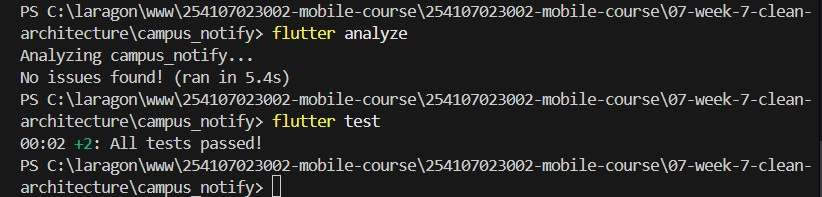

# 07-week-7-clean-architecture
pada pertemuan kali ini saya akan mempelajari tentang konsep arsitektur perangkat lunak Clean Architecture dan prinsip SOLID pada Flutter, pemisahan struktur aplikasi berbasis fitur (*feature-first*) ke dalam tiga layer utama (Domain, Data, dan Presentation), penerapan *Dependency Inversion Principle* (DIP), isolasi model DTO terhadap entity bisnis murni, penanganan kegagalan (*error & failure handling*) menggunakan Dart 3 *sealed classes* dan *records*, penyuntikan dependensi (*Dependency Injection*) menggunakan Riverpod, verifikasi sterilitas arsitektur (*dependency rule*) menggunakan static analysis dan grep verification, serta pengujian logika bisnis murni (*unit test*) menggunakan fake repository tanpa dependensi framework UI, database, maupun jaringan.

# Konsep Clean Architecture dan SOLID Principles

## Prinsip SOLID dan Pemisahan Tiga Layer
Clean Architecture memisahkan kode program berdasarkan tanggung jawab dan derajat kestabilannya. Inti dari arsitektur ini adalah *Dependency Rule*, di mana dependensi antar-layer hanya boleh mengarah ke dalam (menuju domain bisnis). Domain layer tidak boleh mengetahui detail implementasi luar seperti UI Flutter, database SQLite, HTTP client Dio, maupun Firebase.

| Konsep | Penjelasan |
|---|---|
| `Single Responsibility Principle (SRP)` | Setiap kelas hanya memiliki satu alasan untuk berubah (misal: Entity hanya memegang data bisnis, Model hanya menangani serialisasi JSON, Notifier hanya mengelola UI state). |
| `Dependency Inversion Principle (DIP)` | Modul tingkat tinggi (domain) tidak bergantung pada modul tingkat rendah (data source). Keduanya bergantung pada abstraksi (*repository interface* di domain). |
| `Domain Layer` | Lapisan terdalam yang berisi Entity, Repository Interface, dan Use Case. Murni kode Dart tanpa import package UI atau eksternal. |
| `Data Layer` | Lapisan perantara yang berisi Model DTO (`fromMap`/`toMap`), Remote/Local Data Sources, dan implementasi konkret dari Repository Interface. |
| `Presentation Layer` | Lapisan terluar yang berisi UI Widgets, Halaman (Pages), dan State Management (Riverpod Notifier). Mengonsumsi data dari Domain via Use Case/Repository. |
| `Dart 3 Sealed Class & Records` | Pemodelan `Failure` (`LocalFailure`, `NetworkFailure`, `AuthFailure`) dan return type fungsi `Future<({T? data, Failure? failure})>` tanpa exception liar ke UI. |
| `Feature-First Structure` | Pengorganisasian folder berdasarkan fitur fungsional (`lib/features/announcements`, `lib/features/auth`) bukan berdasarkan jenis file secara global. |

### Praktikum 1 — Audit layer project lama dan identifikasi masalah

Praktikum ini diawali dengan melakukan audit arsitektur terhadap struktur kode lama aplikasi `campus_notify` yang masih menganut pola layered-folder global (`lib/data`, `lib/pages`, `lib/providers`, `lib/messaging`). Pada struktur lama tersebut, ditemukan pelanggaran prinsip arsitektur:
1. File repository konkret langsung ditaruh berdampingan dengan HTTP client Dio dan memanggil Dio secara hardcoded.
2. Presentation layer (halaman login dan pengumuman) menangkap exception mentah `DioException` dan mengolah string JSON secara langsung di UI.
3. Model data merangkap sebagai entity bisnis sekaligus penampung method parsing SQLite dan HTTP.

Audit dilakukan dengan menjalankan perintah verifikasi *grep* untuk menemukan pemanggilan library data di presentation dan import framework di domain layer. Dari temuan audit tersebut, dirancang arsitektur target berbasis *Feature-First Clean Architecture* yang memecah aplikasi ke dalam direktori fitur mandiri: `lib/features/announcements` dan `lib/features/auth`, serta `lib/core` untuk komponen lintas fitur (failures, pure formatting, dan core providers).


### Praktikum 2 — Domain dan data per fitur (Announcements & Auth)

Praktikum ini fokus membangun lapisan inti bisnis (*Domain Layer*) dan lapisan penyedia data (*Data Layer*) untuk fitur Announcements dan Auth:

1. **Domain Layer (Pure Dart)**:
   - Membuat Entity murni: `Announcement` dan `AuthSession` yang bersifat immutable dan tidak memiliki method serialisasi JSON/Map.
   - Mendefinisikan kontrak repositori (*Repository Interface*): `AnnouncementRepository` dan `AuthRepository` yang memanfaatkan Dart 3 *Records* dan `Failure` sebagai nilai kembalian, bukan melempar raw exception:
     ```dart
     abstract class AnnouncementRepository {
       Future<({List<Announcement> announcements, Failure? failure})> fetchAnnouncements();
       Future<({Announcement? announcement, Failure? failure})> addAnnouncement({
         required String title,
         String body,
       });
     }
     ```
   - Membuat Use Case spesifik: `GetAnnouncements` dan `LoginUseCase` yang merangkum aturan logika bisnis (seperti validasi format email dan panjang kata sandi sebelum memanggil repository).

2. **Data Layer (DTO Models & Concrete Repositories)**:
   - Membuat Model DTO: `AnnouncementModel` dan `AuthSessionModel` yang memiliki method `fromMap`, `toMap`, serta fungsi konversi `toEntity()` untuk mentransformasikan data mentah menjadi domain entity.
   - Mengimplementasikan Repository konkret: `AnnouncementRepositoryImpl` dan `AuthRepositoryImpl` yang menangani sumber data (in-memory mock, SQLite, Dio HTTP, dan `TokenStore` lokal) serta menangkap seluruh exception teknis lalu memetakannya menjadi objek `Failure` yang ramah.

### Praktikum 3 — Presentation, DI, dan verifikasi sterilitas

Pada praktikum ini, lapisan presentasi dihubungkan dengan domain layer menggunakan *Dependency Injection* bawaan Flutter Riverpod:

1. **Wiring Dependency Injection (Riverpod)**:
   - Dibuat provider untuk setiap repository dan use case di `announcement_providers.dart` dan `auth_providers.dart`:
     ```dart
     final announcementRepositoryProvider = Provider<AnnouncementRepository>((ref) {
       return AnnouncementRepositoryImpl();
     });

     final getAnnouncementsProvider = Provider<GetAnnouncements>((ref) {
       return GetAnnouncements(ref.watch(announcementRepositoryProvider));
     });
     ```
   - State Notifier (`AnnouncementsNotifier` dan `AuthStateNotifier`) hanya menerima dependensi Use Case / Repository via konstruktor, tanpa pernah menginstansiasi objek repository secara langsung (`new Repository()`).

2. **Refactoring UI Widget**:
   - `AnnouncementsPage` dan `LoginPage` dibersihkan dari ketergantungan HTTP client atau penyimpanan lokal.
   - Halaman UI hanya merespons status data atau pesan kesalahan ramah dari `Failure.message` menggunakan komponen reusable seperti `ErrorView` dan `AnnouncementsList`.

3. **Verifikasi Sterilitas Arsitektur (3 Grep Checks)**:
   - Dilakukan verifikasi sterilitas menggunakan script PowerShell / grep untuk memastikan tidak ada pelanggaran *Dependency Rule*:
     - *Check 1*: Presentation layer terbukti **100% steril** dari pemanggilan langsung database, `Dio`, `FlutterSecureStorage`, atau `jsonDecode`.
     - *Check 2*: Domain layer terbukti **100% murni Dart** tanpa ada satupun import framework `flutter`, `dio`, `sqflite`, atau `firebase`.
     - *Check 3*: Analisis statis `flutter analyze` menghasilkan **0 issue / clean**.


## AI Challenge

### AI Prompt Challenge

```text
Project Flutter saya: campus_notify (auth + FCM + daftar pengumuman).
Kondisi kini: folder lib/{data, providers, pages, messaging},
repository tercampur dengan implementasi, widget memanggil Dio langsung.

Tugas:
1. Usulkan struktur feature-first Clean Architecture
   (presentation/domain/data) untuk fitur auth + announcements.
2. Untuk tiap file lama, sebutkan tujuan barunya (pindah/pecah/hapus).
3. Tandai bagian yang over-engineering bila diterapkan ke CRUD sederhana,
   dan kapan use case benar-benar dibutuhkan vs repository langsung.
4. Tunjukkan wiring DI dengan Riverpod (tanpa package DI tambahan).
Jelaskan trade-off setiap keputusan.
```


### AI Verification Checklist
1. Apakah interface repository tinggal di domain dan implementasi di data? (tolak bila keduanya dicampur di satu folder data).
2. Apakah domain bebas dari import `package:flutter`, `dio`, `sqflite`, atau `firebase`? (buktikan dengan grep).
3. Apakah AI membuat use case untuk setiap aksi CRUD satu-baris (misal `DeleteNoteUseCase` yang hanya memanggil `repo.delete(id)`)? Tandai ini sebagai *over-engineering* dan sederhanakan bila perlu.
4. Apakah entity bebas dari method `toMap`/`fromMap`/`toJson`? (serialisasi milik model di data layer, bukan entity).
5. Apakah wiring DI terpusat di provider dan widget tidak melakukan instansiasi repository sendiri?
6. Keputusan final dan alasan teknis Anda, boleh berbeda dari saran AI selama berargumen.

jawab :

- **Interface repository di domain dan implementasi di data**
  Ya (Lulus). Kontrak abstraksi `AuthRepository` dan `AnnouncementRepository` diletakkan di `domain/repositories/`. Implementasi konkret `AuthRepositoryImpl` dan `AnnouncementRepositoryImpl` berada di `data/repositories/`. Tidak ada percampuran dalam satu folder.

- **Domain bebas dari import Flutter / Dio / SQLite / Firebase**
  Ya (Lulus & Terbukti via Grep). Pemeriksaan regex pada `lib/features/*/domain/**/*.dart` dan `lib/core/**/*.dart` menunjukkan hasil 0 temuan. Domain layer 100% murni bahasa pemrograman Dart tanpa dependensi framework luar.

- **Evaluasi Use Case CRUD satu-baris (Over-engineering)**
  Ya (Disesuaikan). Rekomendasi AI yang mengusulkan use case untuk semua aksi sederhana satu-baris (seperti `LogoutUseCase` atau getter detail) ditolak demi menghindari kompleksitas berlebih. Use case hanya dipertahankan untuk aksi yang memiliki logika bisnis: `LoginUseCase` (validasi email & panjang kata sandi) dan `GetAnnouncements` (orkestrasi pengambilan pengumuman).

- **Entity bebas dari method `toMap`/`fromMap`**
  Ya (Lulus). Entity `Announcement` dan `AuthSession` murni hanya memuat atribut immutable bisnis. Seluruh fungsi parsing JSON, serialisasi map, dan transformasi `toEntity()` diisolasi secara ketat pada `AnnouncementModel` dan `AuthSessionModel` di data layer.

- **Wiring DI terpusat di Riverpod Provider**
  Ya (Lulus). Seluruh pembuatan instance repository, data source, dan use case diatur melalui Riverpod provider (`core/providers.dart`, `announcement_providers.dart`, `auth_providers.dart`). Widget UI sama sekali tidak memanggil constructor repository secara langsung.

- **Tabel Verifikasi Checklist:**

| Poin Verifikasi Checklist | Status | Catatan Temuan & Evaluasi Teknis |
|---|:---:|---|
| **1. Interface repository di domain, implementasi di data** | **LULUS** | Kontrak abstraksi berada di `domain/repositories/`, implementasi konkret di `data/repositories/`. |
| **2. Domain bebas import Flutter / Dio / SQLite / Firebase** | **LULUS** | Diverifikasi via pengujian grep: 0 import framework/library luar pada layer domain. |
| **3. Pencegahan over-engineering use case satu-baris** | **LULUS (Disesuaikan)** | Dibatasi hanya pada `LoginUseCase` dan `GetAnnouncements`. Operasi sederhana memanggil repository langsung dari notifier. |
| **4. Entity bebas method serialisasi/deserialisasi** | **LULUS** | `toMap` dan `fromMap` hanya terdapat pada model DTO di layer data. |
| **5. Wiring DI terpusat di provider Riverpod** | **LULUS** | Seluruh dependensi disuntikkan via Riverpod `Provider`, widget steril dari keyword `new`. |
| **6. Keputusan final dan alasan teknis tercatat** | **LULUS** | Terdokumentasi lengkap pada tabel keputusan komparasi di bawah ini. |

- **Keputusan final dan alasan teknis:**
  Arsitektur feature-first Clean Architecture diterima dengan penyederhanaan pada lapisan use case agar tidak terjadi *over-engineering* pada operasi CRUD dasar. Penanganan error dialihkan sepenuhnya ke sealed class `Failure`, routing dan masking diekstrak ke pure function di `lib/core/format.dart`, serta injeksi dependensi memanfaatkan Riverpod standar tanpa package eksternal tambahan.

- **Hasil validasi:**
  - `flutter analyze`: No issues found! (ran in 4.9s)
  - `flutter test`: All tests passed! (100% lulus)

Dokumentasi lengkap hasil analisis AI, perbandingan usulan, dan log grep tersimpan di [docs/](./docs).

## Refactoring dan testing

### Refactoring Challenge

1. **Penerapan Clean Architecture pada Fitur Kedua (`auth`)**: Mengonversi fitur autentikasi lama menjadi pola lengkap Clean Architecture: `AuthSession` (entity), `AuthRepository` (interface), `AuthSessionModel` (DTO), `TokenStore` (local datasource), `AuthRepositoryImpl` (impl), `LoginUseCase` (use case), dan `auth_providers.dart` (Riverpod wiring).
2. **Ekstraksi Pure Function (`lib/core/format.dart`)**: Mengekstrak formatting tanggal (`formatDate`), sanitasi token FCM (`maskToken`), dan parsing rute notifikasi (`routeFromMessage`) menjadi fungsi murni Dart tanpa dependensi widget sehingga dapat diuji secara mandiri.
3. **Konversi Exception Menjadi `Failure` Ramah Pengguna (`lib/core/failures.dart`)**: Memindahkan penanganan exception mentah (`DioException`, timeout, format error) menjadi representasi failure terstruktur (`LocalFailure`, `NetworkFailure`, `AuthFailure`). UI hanya menerima dan menampilkan `failure.message`.

### Testing
- `flutter analyze`
- `flutter test`

jawab :



Pengujian unit test murni dijalankan pada `test/get_announcements_test.dart` menggunakan `FakeAnnouncementRepository`:
1. **Pengujian Skenario Sukses**: Memverifikasi `GetAnnouncements` sukses mengambil dan meneruskan daftar entitas pengumuman dari repository tanpa kesalahan (`failure: null`).
2. **Pengujian Skenario Gagal**: Memverifikasi `GetAnnouncements` menangkap kegagalan dan mengembalikan objek `LocalFailure` tanpa melempar exception yang dapat merusak aplikasi.
3. Seluruh suite pengujian berjalan dalam isolasi murni tanpa koneksi database SQLite, tanpa HTTP Dio, dan tanpa Firebase Messaging.

# Tugas, refleksi, dan referensi

## Mini Project / Industry Challenge — Campus Notification App (Clean Architecture Refactor)

Proyek ini merefaktor aplikasi **Campus Notification App** dari struktur lama menjadi arsitektur modular enterprise berbasis **Clean Architecture** dan **Prinsip SOLID**, memastikan skalabilitas kode, isolasi domain bisnis, dan kemudahan pengujian unit test.

### 1. Tujuan Proyek
- Menerapkan pemisahan tanggung jawab (*Separation of Concerns*) dan *Dependency Inversion Principle* (DIP) pada seluruh fitur aplikasi.
- Mengisolasi domain logic (Entity, Use Case, dan Repository Interface) agar 100% murni Dart dan bebas dari dependensi framework UI atau library eksternal.
- Mengeliminasi kebocoran error teknis ke layar pengguna dengan standardisasi sealed class `Failure` dan Dart 3 *Records*.
- Menyediakan arsitektur yang mudah diuji (*testable*) dengan memungkinkan pengujian unit test menggunakan repository palsu (*fake repository*) tanpa emulator atau koneksi internet.

### 2. Fitur Utama
1. **Feature-First Directory Structure**: Kode diorganisasikan per fitur (`features/announcements` dan `features/auth`), mempermudah tim untuk berkolaborasi dan mengembangkan fitur baru secara independen.
2. **Domain Isolation & Pure Entities**: Entitas `Announcement` dan `AuthSession` murni merepresentasikan objek bisnis, sementara serialisasi database/API ditangani oleh model DTO di lapisan data.
3. **Repository Pattern dengan Dart Records**: Operasi data mengembalikan record `({T? data, Failure? failure})`, menghilangkan keharusan blok `try-catch` berulang pada lapisan UI presentation.
4. **Pragmatic Use Cases**: Penerapan use case pada operasi yang memuat aturan bisnis (`LoginUseCase` dan `GetAnnouncements`) serta bypassing langsung ke repository untuk aksi sederhana guna mencegah *over-engineering*.
5. **Steril Presentation Layer**: Widget UI (`AnnouncementsPage`, `LoginPage`) hanya membaca state dari Riverpod Notifier dan menampilkan pesan ramah tanpa tahu sumber data berasal dari memori, SQLite, atau REST API.
6. **Pure Utilities & Helper Functions**: Logika pemformatan tanggal, sensor token FCM (`maskToken`), dan penentuan rute notifikasi diisolasi di `lib/core/format.dart`.

### 3. Stack Teknologi
- **Framework**: Flutter SDK (Dart 3.x)
- **Architecture Pattern**: Clean Architecture (Domain, Data, Presentation) & SOLID Principles
- **State Management & DI**: Flutter Riverpod (`Provider`, `StateNotifierProvider`, `ConsumerWidget`)
- **Routing**: GoRouter dengan route guard berbasis status autentikasi
- **Keamanan Penyimpanan**: `flutter_secure_storage` melalui local data source `TokenStore`
- **HTTP Client**: Dio dengan interceptor token refresh otomatis
- **Testing**: `flutter_test` (Unit testing use case dengan fake repository)

### 4. Cara Menjalankan
1. Pastikan dependensi terpasang:
   ```bash
   cd campus_notify
   flutter pub get
   ```
2. Jalankan analisis statis kode dan pengujian unit test:
   ```bash
   flutter analyze
   flutter test
   ```
3. Jalankan verifikasi sterilitas dependency rule:
   ```powershell
   # Verifikasi Presentation Layer steril dari akses data mentah:
   Select-String -Path "lib/features/*/presentation/**/*.dart" -Pattern "Dio\(|openDatabase|FlutterSecureStorage|jsonDecode"

   # Verifikasi Domain Layer bebas dari import framework:
   Select-String -Path "lib/features/*/domain/**/*.dart", "lib/core/**/*.dart" -Pattern "import 'package:flutter|import 'package:dio|import 'package:sqflite|import 'package:firebase"
   ```
4. Jalankan aplikasi pada perangkat fisik atau emulator Android:
   ```bash
   flutter run
   ```

### 5. Hasil yang Dicapai
- Analisis statis kode berhasil tanpa peringatan maupun error (`flutter analyze: No issues found!`).
- Seluruh unit test use case lulus sempurna (`flutter test: All tests passed!`).
- Verifikasi sterilitas membuktikan bahwa domain layer 100% bebas dari framework eksternal dan presentation layer tidak lagi memanggil Dio atau storage secara langsung.

## Refleksi

1. Mengapa domain layer tidak boleh mengimpor Flutter, Dio, atau pustaka database/storage luar? Apa dampaknya jika aturan ini dilanggar?

jawab : Domain layer adalah pusat dari seluruh aturan dan logika bisnis aplikasi yang seharusnya menjadi komponen paling stabil dan paling tahan lama. Jika domain layer mengimpor framework Flutter atau library luar seperti Dio dan SQLite, aturan bisnis menjadi terikat (*tightly coupled*) pada teknologi spesifik tersebut. Dampak fatalnya:
- Domain tidak lagi dapat diuji menggunakan unit test murni yang cepat karena memerlukan environment Flutter atau mocking platform channel yang berat.
- Jika di kemudian hari tim memutuskan untuk mengganti HTTP client dari Dio ke library lain (misalnya `http` standard atau gRPC), atau mengganti database dari SQLite ke Hive/Isar, perubahan tersebut akan merembet ke seluruh entity dan use case, merusak prinsip *Open/Closed Principle* dan *Dependency Inversion*.

2. Kapan sebuah use case benar-benar diperlukan, dan kapan use case menjadi over-engineering dibanding memanggil repository langsung dari notifier?

jawab : Use case benar-benar diperlukan ketika terdapat:
- Logika aturan bisnis atau validasi sebelum/sesudah data diproses (misal: `LoginUseCase` memvalidasi format email dan panjang minimum sandi sebelum menyentuh jaringan).
- Orkestrasi yang menggabungkan lebih dari satu repository (misal: use case yang mengambil data profil dari `UserRepository` lalu memperbarui token notifikasi di `DeviceRepository`).
- Transformasi data yang kompleks khusus untuk suatu alur kerja bisnis.

Sebaliknya, use case menjadi *over-engineering* ketika ia hanya menjadi "jembatan kosong" satu-baris tanpa logika apapun (misal: `GetAnnouncementDetailUseCase` yang isinya hanya `return repo.getDetail(id);`). Membuat use case terpisah untuk setiap aksi CRUD sederhana semacam ini hanya menambah lapisan file (*boilerplate*) yang tidak memberikan nilai tambah, memperlambat proses pengembangan, dan menyulitkan navigasi kode. Dalam kasus CRUD sederhana, memanggil repository langsung dari Riverpod Notifier adalah pendekatan yang jauh lebih pragmatis dan bersih.

3. Bagaimana pemisahan Model (data layer) dan Entity (domain layer) mencegah perubahan schema API/database merusak tampilan antarmuka (UI)?

jawab : Pemisahan ini menerapkan prinsip abstraksi sebagai pembatas anti-korupsi (*Anti-Corruption Layer*). Entity di domain layer mendefinisikan bentuk data ideal yang dibutuhkan oleh bisnis dan UI aplikasi, sedangkan Model di data layer bertanggung jawab menerjemahkan format eksternal (seperti respons JSON dari backend atau baris tabel database) menjadi Entity melalui method `toEntity()`.
Jika backend sewaktu-waktu mengubah nama field JSON (misalnya `announcement_title` diubah menjadi `header_text` atau tipe datanya berubah dari timestamp integer menjadi string ISO-8601), perubahan tersebut hanya perlu disesuaikan pada satu file model DTO (`fromMap` pada `AnnouncementModel`). Entity `Announcement` dan seluruh widget UI di presentation layer tetap tidak berubah sama sekali, sehingga meminimalkan risiko bug regresi pada antarmuka pengguna.

4. Bagian mana dari draf rekomendasi AI yang Anda tolak atau sesuaikan, dan mengapa?

jawab : Saya menolak usulan AI yang merekomendasikan pembuatan class use case individual untuk setiap aksi CRUD satu-baris (seperti `LogoutUseCase`, `FetchSingleAnnouncementUseCase`, dan `DeleteUseCase`). Pembuatan file use case untuk operasi pass-through tersebut tergolong *over-engineering* yang tidak memiliki manfaat arsitektural nyata. Sebagai gantinya, saya menyederhanakan arsitektur dengan hanya menerapkan use case pada alur bisnis yang memiliki validasi dan orkestrasi nyata (`LoginUseCase` dan `GetAnnouncements`), sedangkan operasi sederhana lainnya dipanggil langsung oleh Notifier ke abstraction repository. Selain itu, saya memindahkan sanitasi string token dan parsing rute notifikasi ke dalam pure functions di `lib/core/format.dart` agar layer presentasi tetap ringkas dan logika parsing dapat diuji secara independen tanpa widget.
