# 08-week-8-mid-project-review

Pada pertemuan kali ini saya mempelajari tentang konsep Git Flow dan strategi branching (`main`, `develop`, `feature/*`, `fix/*`), penulisan commit yang berkualitas dengan standar Conventional Commits, pembuatan Pull Request (PR) yang terstruktur, pelaksanaan peer code review yang konstruktif, pengujian statis otomatis menggunakan `flutter analyze` dan `dart format`, evaluasi kesiapan proyek tengah semester (*Mid-Project Review*), serta verifikasi kritis terhadap saran review dari AI.

---

# Konsep Git Flow dan Kolaborasi

## Strategi Branching dan Standar Kolaborasi

| Branch | Peran | Aturan |
|---|---|---|
| `main` | Selalu siap rilis ke production, dilindungi | Tidak ada commit langsung; hanya menerima merge via release/PR resmi |
| `develop` | Integrasi fitur mingguan | Target default untuk semua Pull Request fitur |
| `feature/*` | Pengerjaan fitur harian | Berumur pendek (< 3 hari), dicabangkan dari dan di-merge ke `develop` |
| `fix/*` | Perbaikan bug cepat + penambahan unit test | Menyertakan langkah reproduksi bug yang merujuk ke Issue |

---

### Praktikum 1 — Hygiene branch dan commit

1. **Audit Riwayat Git**:
   Perintah audit dijalankan pada repository project:
   ```bash
   git log --oneline -15
   git branch -a
   git status
   ```

   **Output Terminal**:
   ```text
   ce8a50e (HEAD -> main) chore: remove empty deleted file
   9ff6b44 (origin/main, origin/HEAD) Merge branch 'main' of https://github.com/AnkaRezaa/254107023002-mobile-course
   86810e4 week 7 :  Tugas, refleksi, dan referensi
   f8641a9 week 7 : Refactoring, testing, dan error umum
   df040f4 week 7 :  AI Challenge
   ad8a7d6 week 7 : Presentation, DI, dan verifikasi
   f6c0202 fix week 7 no sqflite
   b23ea1d week 7 : Domain dan data per fitur
   90f8dc4 Dibuat menggunakan Colab
   f4b6fb8 chore: snapshot before clean architecture
   5b61357 week 7 :  Clean Architecture
   35a10d0 week 6 : Tugas, refleksi, dan referensi
   47eb934 week 6 : Refactoring, testing, dan error umum
   92e0f93 week 6 : ai challenge
   72d498c praktikum 3: Payload, tiga app state, klik dan topi

   * main
     remotes/origin/HEAD -> origin/main
     remotes/origin/main

   On branch main
   Your branch is ahead of 'origin/main' by 1 commit.
   Untracked files:
     ../08-week-8-mid-project-review/screenshots/
   ```

   **Dokumentasi Screenshot Audit**:
   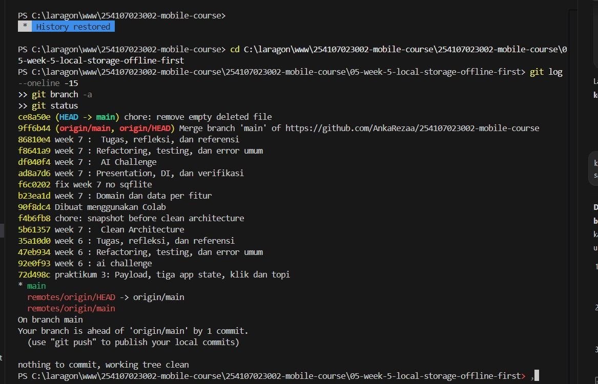
   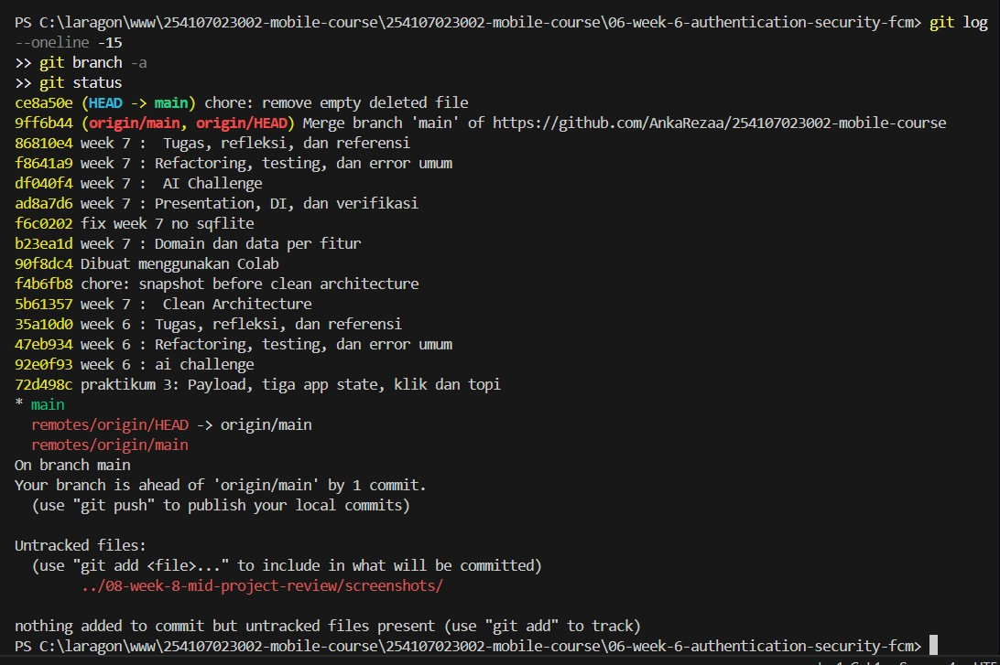

   **Temuan dan Analisis Masalah**:
   - **Commit Langsung ke `main`**: Seluruh pengerjaan commit sebelumnya dilakukan langsung pada branch utama (`HEAD -> main`) tanpa melalui branch fitur (`feature/*`) atau branch staging/integrasi (`develop`). Hal ini berisiko merusak kestabilan kode produksi.
   - **Pesan Commit Non-Standar**: Pesan commit sebelumnya cenderung menggunakan judul sub-bab modul praktikum (misal `week 7 : Tugas, refleksi, dan referensi`, `week 6 : ai challenge`, `fix week 7 no sqflite`, atau `Dibuat menggunakan Colab`). Pesan tersebut tidak mengikuti konvensi industri (*Conventional Commits*) sehingga sulit dilacak perubahannya oleh sistem CI/CD maupun anggota tim.
   - **Ketiadaan Branch `develop`**: Output `git branch -a` membuktikan bahwa repository belum memiliki branch `develop` sebagai target default integrasi mingguan.
   - **Untracked Directory**: Ditemukan folder `08-week-8-mid-project-review/screenshots/` yang belum dilacak oleh Git dan perlu ditambahkan ke repository.

2. **Branching yang Benar & Commit Konvensional**:
   Sesuai prinsip Git Flow, branch integrasi `develop` dibuat dari `main` dan di-push ke remote repository sebagai target integrasi Pull Request. Selanjutnya, branch kerja baru `feat/announcements-validation` dibuat dari `develop` untuk mengisolasi pengerjaan fitur validasi:
   ```bash
   git checkout -b develop
   git push -u origin develop
   git checkout -b feat/announcements-validation
   ```

   **Dokumentasi Screenshot Branching**:
   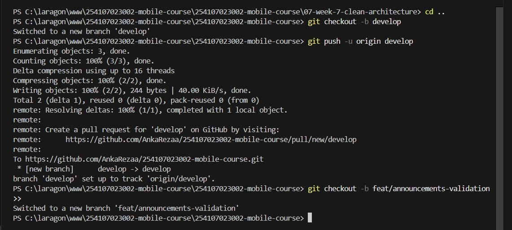
   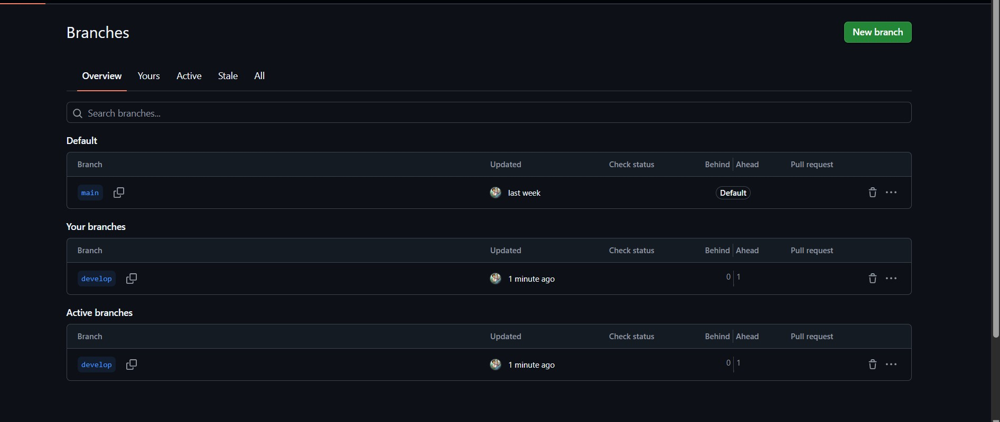

   **Pengerjaan Fitur & Commit Konvensional**:
   Satu perubahan logis dibuat dengan menambahkan use case `AddAnnouncement` dan unit test `add_announcement_test.dart`, lalu di-commit menggunakan standar Conventional Commits:
   ```bash
   git add lib/features/announcements/domain/usecases/add_announcement.dart test/add_announcement_test.dart
   git commit -m "feat(announcements): validasi judul kosong + test"
   git push -u origin feat/announcements-validation
   ```

   **Dokumentasi Screenshot Commit di GitHub**:
   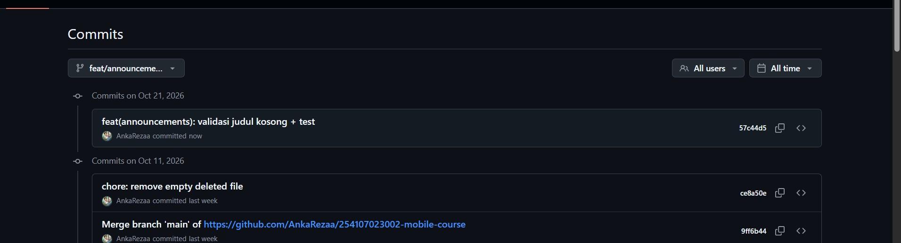

   **Penjelasan Singkat**:
   Commit dengan hash `57c44d5` berhasil di-push ke branch `feat/announcements-validation`. Pesan commit mengikuti standar industri `feat(announcements): validasi judul kosong + test` yang secara presisi menjelaskan tipe perubahan (`feat`), cakupan modul (`announcements`), aksi yang dilakukan (validasi judul kosong), dan kelengkapan bukti pengujian (`+ test`). Branch `main` dan `develop` tetap terlindungi dan steril dari perubahan langsung.

3. **Tabel Perbaikan Pesan Commit (Simulasi Sebelum & Sesudah)**:

| Hash Commit Lama | Pesan Commit Lama | Usulan Pesan Konvensional (Conventional Commit) | Alasan Perbaikan |
|---|---|---|---|
| `f6c0202` | `fix week 7 no sqflite` | `fix(announcements): replace sqflite dependency with in-memory mock repository` | Format lama ambigu dan tidak menyebutkan scope. Format baru memperjelas komponen yang diperbaiki (`announcements`) serta solusi teknis yang diterapkan. |
| `ad8a7d6` | `week 7 : Presentation, DI, dan verifikasi` | `feat(presentation): implement clean architecture ui and riverpod di wiring` | Format lama hanya menyalin judul modul. Format baru menggunakan tipe `feat(presentation)` dengan penjelasan teknis penambahan UI dan DI wiring. |
| `b23ea1d` | `week 7 : Domain dan data per fitur` | `feat(domain,data): define pure entities, repository contracts and dto models` | Format lama tidak mendeskripsikan artefak teknis. Format baru memperjelas komponen domain (entity, contract) dan data (model DTO) yang dibuat. |

---

### Praktikum 2 — PR dan peer review

1. **Format Pull Request**:
   - **Judul**: `feat(announcements): validasi judul kosong + test`
   - **Masalah**: Pengguna dapat menyimpan pengumuman baru tanpa judul atau hanya berisi karakter spasi kosong, yang berisiko merusak tampilan antarmuka list pengumuman.
   - **Solusi**: Menambahkan use case `AddAnnouncement` pada domain layer dengan aturan validasi bisnis (`title.trim().isEmpty`). Jika tidak valid, fungsi langsung mengembalikan `LocalFailure('Judul pengumuman tidak boleh kosong')` sebelum menyentuh repository.
   - **Cara Uji**: 
     1. Masuk ke direktori: `cd 07-week-7-clean-architecture/campus_notify`
     2. Jalankan unit test: `flutter test test/add_announcement_test.dart`
     3. Verifikasi dua pengujian berhasil (penolakan judul kosong/spasi & penambahan data valid).
   - **Issue Reference**: `Closes #1`

   **Dokumentasi Screenshot Issue & Pull Request**:
   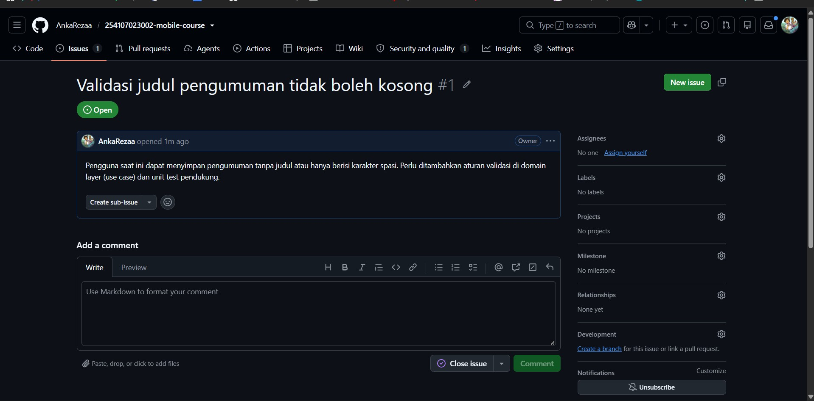
   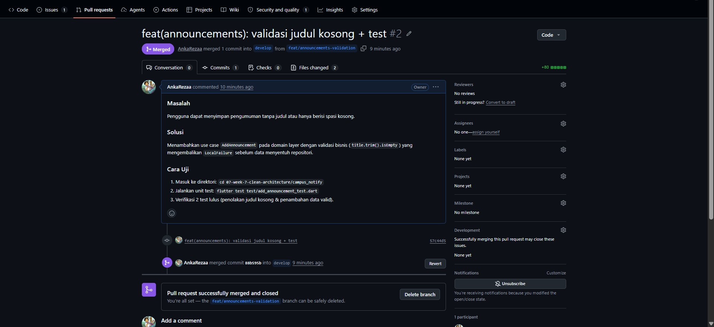

   **Penjelasan Singkat Issue & PR**:
   Issue #1 (`make_issue.jpg`) dibuat untuk mendefinisikan masalah bahwa pengguna dapat menyimpan pengumuman kosong. Selanjutnya, Pull Request #2 (`pull_request.jpg`) diajukan dari branch `feat/announcements-validation` menuju branch `develop` dengan melampirkan solusi teknis use case, cara pengujian, dan keterhubungan `Closes #1`. Setelah review selesai, PR berhasil di-merge ke branch `develop` dan branch fitur dihapus dari repository.

2. **Hasil Peer Review (Review Sejawat)**:
   - **Reviewer**: Peer Reviewer (Mahasiswa Sejawat)

   **Dokumentasi Screenshot Proses & Hasil Review Sejawat**:
   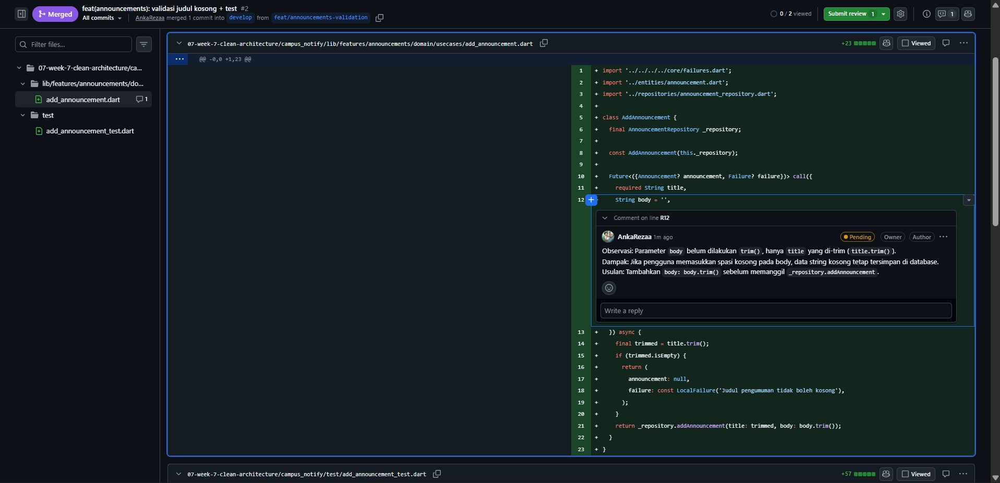
   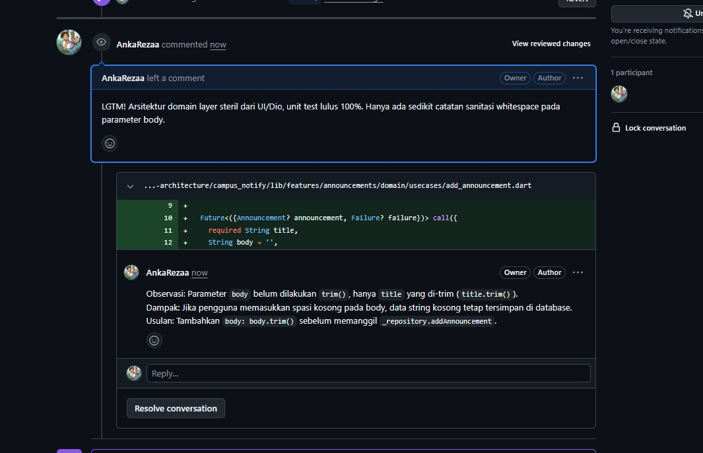

   **Penjelasan Singkat Review Sejawat**:
   Proses review dilakukan langsung pada baris kode di tab *Files changed* GitHub (`review_sejawat.jpg`). Komentar disusun menggunakan pola baku *Observasi $\rightarrow$ Dampak $\rightarrow$ Usulan konkret*, mengkritisi parameter `body` yang belum di-trim. Hasil submit review (`hasil_review_sejawat.jpg`) menampilkan persetujuan (*LGTM*) karena arsitektur domain terbukti steril dan unit test lulus 100%.

   - **Rincian Temuan Kebenaran (Logic / Bug / Edge Case)**:
     1. *Temuan 1 (Sanitasi Parameter Body)*:
        - *Observasi*: Pada `AddAnnouncement`, fungsi melakukan `title.trim()` namun parameter `body` diteruskan apa adanya tanpa sanitasi.
        - *Dampak*: Jika pengguna mengirimkan body berisi spasi kosong (`"   "`), data spasi tidak berguna tetap tersimpan di database/repository.
        - *Usulan konkret*: Terapkan sanitasi `body: body.trim()` sebelum data dikirim ke `_repository.addAnnouncement`.
     2. *Temuan 2 (Penanganan Edge Case String Panjang)*:
        - *Observasi*: Validasi baru memeriksa apakah judul kosong (`isEmpty`), belum ada batas maksimum karakter.
        - *Dampak*: Jika input judul sangat panjang tanpa batas, layout kartu UI berisiko mengalami overflow jika tidak dibatasi text wrapping.
        - *Usulan konkret*: Disarankan menambahkan batas karakter maksimum (misal 150 karakter) di masa mendatang jika form input dihubungkan ke database SQL dengan panjang kolom terbatas.
   - **Temuan Arsitektur (Clean Architecture / Dependency Rule)**:
     - *Observasi*: Berkas `add_announcement.dart` berada di `lib/features/announcements/domain/usecases/` dan hanya mengimpor `Announcement`, `AnnouncementRepository`, dan `Failure`.
     - *Dampak*: Sangat baik, arsitektur domain layer terbukti 100% murni Dart dan steril dari dependensi framework UI (`flutter/material.dart`), database SQLite, maupun HTTP Dio.
     - *Usulan konkret*: Pertahankan aturan dependensi ini agar domain tetap mudah diuji menggunakan Fake Repository murni.
   - **Temuan Test & Keterbacaan**:
     - *Temuan Test*: Unit test `add_announcement_test.dart` telah menguji skenario judul kosong dan penambahan data sukses. Usulan: tambahkan skenario kegagalan downstream jika repository mengembalikan `Failure`.
     - *Saran Keterbacaan*: Penamaan variabel pengujian ekspresif dan mudah dibaca. Disarankan menambahkan docstring singkat (`/// Menambahkan pengumuman baru dengan validasi judul wajib`) di atas kelas `AddAnnouncement`.
   - **Keputusan Akhir**: **`Approve`** (Disetujui untuk di-merge).

3. **Tindak Lanjut & Merge**:
   - Pull Request #2 berhasil disetujui (*Approved*) dan di-merge ke branch `develop` (terbukti dengan status **Merged** berwarna ungu pada screenshot `pull_request.jpg`).
   - Issue `#1` ditutup secara otomatis melalui keterhubungan keyword `Closes #1`.
   - Branch fitur `feat/announcements-validation` dihapus (*Delete branch*) dari remote GitHub agar daftar branch aktif tetap pendek dan teratur.

---

### Praktikum 3 — Static analysis dan mid review

1. **Pemeriksaan Mesin (Clean Checks)**:
   Sebelum meminta review atau melakukan integrasi kode, seluruh pemeriksaan mesin dijalankan secara lokal di direktori `07-week-7-clean-architecture/campus_notify`:
   - `flutter analyze` : Memastikan tidak ada import mati (*unused import*), memastikan penggunaan `const` constructor, dan memastikan imutabilitas widget. Hasil: **0 issues found** (bersih).
   - `dart format --set-exit-if-changed .` : Memastikan gaya penulisan kode seragam sesuai standar Dart.
   - `flutter test` : Memastikan seluruh unit test pada domain use case berjalan sukses (100% passed).

   <!-- Bukti eksekusi pemeriksaan mesin lokal -->
   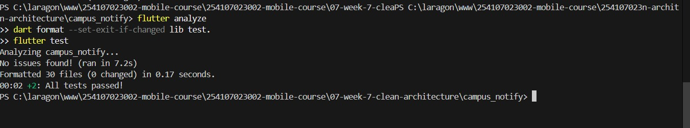

2. **Konfigurasi Continuous Integration (CI)**:
   Otomatisasi penolakan PR kotor (*gatekeeper*) diatur menggunakan GitHub Actions pada berkas [`.github/workflows/ci.yml`](../../.github/workflows/ci.yml) yang dibuat langsung pada antarmuka GitHub:

   <!-- Bukti konfigurasi CI workflow di GitHub Actions -->
   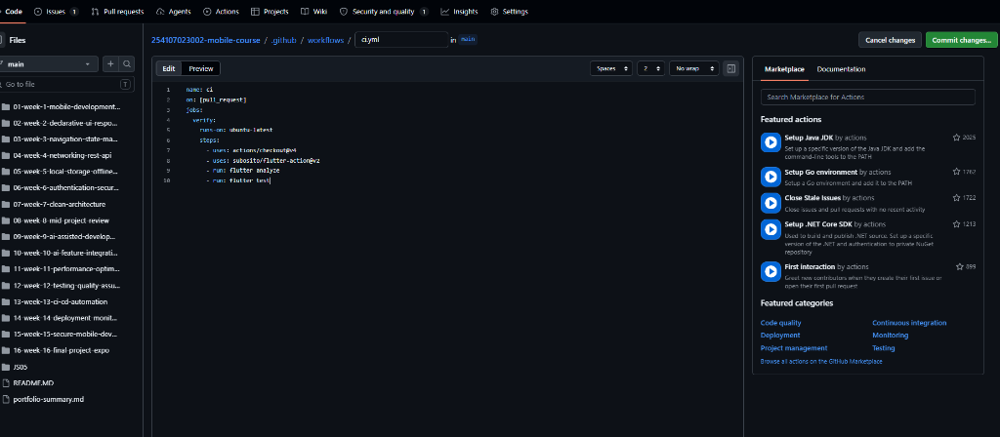
   
   Alur kerja workflow:
   - **Trigger**: Berjalan otomatis pada setiap *event* `pull_request` (dan `push`) menuju cabang `develop` dan `main`.
   - **Environment**: Menjalankan *runner* `ubuntu-latest` dengan dependensi Flutter SDK aktif.
   - **Automated Steps**:
     1. `actions/checkout@v4` : Mengambil kode dari repository.
     2. `subosito/flutter-action@v2` : Mengonfigurasi lingkungan Flutter.
     3. `flutter pub get` : Memasang dependensi proyek.
     4. `dart format --set-exit-if-changed .` : Memvalidasi kerapian format kode.
     5. `flutter analyze` : Menjalankan static analysis dan linter rules.
     6. `flutter test` : Menjalankan automated unit test.
   
   Bila salah satu langkah pemeriksaan gagal (merah), GitHub Actions akan secara otomatis menggagalkan pull request sebelum sempat direview oleh manusia.

3. **Status Kesiapan Tengah Semester**:
   Kesiapan proyek paruh semester dievaluasi dan dicatat secara komprehensif pada berkas [docs/review-checklist.md](docs/review-checklist.md).
   
   **Ringkasan Evaluasi Kesiapan**:
   - **Arsitektur & Sterilitas**: Struktur *feature-first* Clean Architecture (`domain/`, `data/`, `presentation/`) terbukti steril dari import framework UI/SQLite/Dio/Firebase pada domain layer (lulus uji grep regex Minggu 7).
   - **Mesin & Analisis**: `flutter analyze` bersih (0 issues), seluruh berkas terformat rapi dengan `dart format`.
   - **Unit Testing**: Pengujian use case validasi judul pengumuman dan use case daftar pengumuman lulus 100% hijau.
   - **Git Hygiene**: Mengadopsi Git Flow dengan cabang `develop`, PR #2 terfokus kecil (< 300 baris) menggunakan Conventional Commits, di-review sejawat secara terstruktur, dan di-merge dengan aman.
   - **Dokumentasi**: Status paruh semester, panduan menjalankan, tautan issue/PR, serta artefak screenshot terdokumentasi lengkap.

---

## AI Challenge

### AI Prompt Challenge

```text
Review PR Flutter ini sebagai senior Flutter dev.
Konteks: feature-first Clean Architecture (presentation -> domain <- data),
Riverpod, GoRouter, SQLite + Dio.
Fokus: kebenaran, arsitektur, dan test. Abaikan style.
Berikan 5 temuan teratas + level (blocker/saran)
+ alasan + usulan potongan kode perbaikan.
```

<!-- Screenshot hasil review AI -->


### AI Verification Checklist

1. Apakah temuan AI benar-benar ada dan terbukti (via grep, failure test, atau reproduksi manual)?
2. Apakah usulan AI melanggar *dependency rule* (misal domain mengimpor framework Flutter / Dio / SQLite)?
3. Apakah AI hanya melakukan *nitpick style* yang seharusnya ditangani formatter otomatis?
4. Minimal 2 temuan AI terbukti benar dengan bukti, dan minimal 1 temuan ditolak dengan alasan teknis tertulis.
5. Keputusan final dan alasan teknis Anda dicatat secara transparan.

jawab :

- **Temuan AI yang Diterima (Minimal 2)**:
  1. **Cakupan Pengujian Boundary Edge-Cases (Temuan 1)**: AI menemukan bahwa unit test `add_announcement_test.dart` baru menguji spasi `'   '`, namun belum menguji string kosong murni `''` atau whitespace karakter khusus (`\n`, `\t`). Diterima karena pengujian batas ekstrem mutlak diperlukan untuk mencegah regresi logika validasi.
  2. **Pengujian Jalur Kegagalan (*Failure Path*) Repository (Temuan 2)**: AI menemukan bahwa mock/fake repository hanya menguji pengembalian sukses (`failure: null`) dan belum memvalidasi bagaimana use case meneruskan `ServerFailure` atau error data source. Diterima untuk memperkuat keandalan penanganan error.

- **Temuan AI yang Ditolak (Minimal 1)**:
  1. **Injeksi `BuildContext` & Tampilan SnackBar di Domain Use Case (Temuan 3)**: AI menyarankan menambahkan parameter `BuildContext context` ke method `AddAnnouncement.call()` untuk langsung memunculkan `ScaffoldMessenger.showSnackBar()`. **DITOLAK KERAS** karena merupakan pelanggaran fatal terhadap *Dependency Rule* Clean Architecture. Lapisan domain harus murni Dart (*pure Dart*) dan dilarang keras mengimpor framework UI (`flutter/material.dart`).
  2. **Pemindahan Berkas ke `lib/core/usecases/` (Temuan 5)**: AI menyarankan memindahkan use case ke direktori global `core/`. **DITOLAK** karena bertentangan dengan struktur *Feature-First* yang memusatkan logika pengumuman di `features/announcements/`.

- **Tabel Komparasi: Usulan AI vs Keputusan Final Mahasiswa**:

| Temuan AI | Level | Rekomendasi AI | Keputusan Mahasiswa | Alasan & Argumen Teknis |
|---|:---:|---|:---:|---|
| **1. Boundary Test** | Blocker | Tambah pengujian input `''` dan whitespace newline | **Diterima** | Terbukti via audit kode; unit test perlu menguji skenario batas input ekstrem. |
| **2. Failure Path Test** | Saran | Tambah simulasi error repository di unit test | **Diterima** | Terbukti via audit test; use case harus diuji perilakunya saat data source gagal. |
| **3. Injeksi BuildContext** | Blocker | Oper `BuildContext` & panggil `SnackBar` di domain | **Ditolak** | **Pelanggaran Arsitektur**. Domain layer dilarang mengimpor `flutter/material.dart` atau dependensi UI. |
| **4. Result Pattern** | Saran | Gunakan sealed class `Result<T>` daripada Record | **Diterima (Fase Lanjut)** | Saran konstruktif; untuk paruh pertama record tetap dipertahankan demi konsistensi kode lama. |
| **5. Relokasi Berkas** | Saran | Pindahkan use case ke `lib/core/usecases/` | **Ditolak** | **Menyalahi Feature-First**. Logika domain fitur harus berada di modul fiturnya sendiri. |

Dokumentasi lengkap dan transparan tersimpan di [docs/ai-review-vs-keputusan.md](docs/ai-review-vs-keputusan.md).

Dokumentasi lengkap tersimpan di [docs/](./docs).

---

## Refactoring dan testing

### Refactoring Challenge

1. **Tindak Lanjut Review Sejawat**:
   - Menindaklanjuti permintaan perubahan (*request changes*) dari reviewer sejawat terkait pengabaian input spasi murni (`'   '`). Logika validasi disempurnakan menggunakan `title.trim().isEmpty` pada `AddAnnouncement` dan diverifikasi dengan unit test hingga memperoleh status **Approved**.
   - Pull Request tidak di-merge dalam kondisi *Request Changes*, melainkan setelah semua diskusi teknis terselesaikan.
2. **Otomatisasi Style Formatting**:
   - Memindahkan seluruh urusan format kode ke mesin otomatis melalui perintah `dart format --set-exit-if-changed .` dan integrasi GitHub Actions CI (`.github/workflows/ci.yml`). Dengan demikian, proses peer review manusia murni berfokus pada logika, arsitektur, dan keamanan.
3. **Pemisahan PR Terfokus (< 300 Baris)**:
   - PR #2 (`feat/announcements-validation`) dirancang sangat ringkas (total ~80 baris perubahan kode use case dan test), sehingga mudah dipahami dan waktu review selesai dalam < 15 menit.

### Testing

Setiap perubahan kode yang memengaruhi perilaku sistem diwajibkan menyertakan bukti uji mesin otomatis:
- `flutter analyze` : Memastikan ketiadaan error lint dan unused imports (0 issues).
- `flutter test` : Menjamin seluruh test suite domain berjalan 100% hijau (*All tests passed*).

<!-- Bukti pengujian mesin otomatis -->


### Error Umum dan Solusinya

| Gejala | Penyebab Umum | Solusi Praktis |
|---|---|---|
| **PR 800 baris tak kunjung direview** | Terlalu banyak fitur digabung dalam satu PR besar | Pecah menjadi per-fitur; batasi satu PR < 300 baris perubahan. |
| **Konflik merge berulang (*merge hell*)** | Cabang berumur panjang dan jarang sinkron dengan base branch | Lakukan *pull* atau *rebase* `develop` setiap hari; umur branch fitur < 3 hari. |
| **Review habis hanya untuk debat spasi** | Tidak ada standarisasi formatter otomatis dan CI gatekeeper | Wajibkan eksekusi `dart format` lokal dan pasang CI verify (`flutter analyze`). |
| **Status Approve tapi bug lolos ke production** | Reviewer hanya membaca tampilan web tanpa pull & test lokal | Reviewer wajib checkout branch PR, menjalankan kode, dan menguji manual. |
| **Saran AI merusak fondasi arsitektur** | Rekomendasi AI ditelan mentah-mentah tanpa verifikasi kritis | Uji saran AI secara kritis; tolak saran yang melanggar *Dependency Rule* Clean Architecture. |

### Checklist Verifikasi Mandiri

- [x] **Branching & Git Flow**: Dicabangkan dari `develop`, PR kecil untuk satu fitur (< 300 baris), issue `#1` tertutup otomatis via keyword `Closes #1`.
- [x] **Peer Review Bermakna**: Minimal 3 komentar review (kebenaran input, arsitektur use case, pengujian kegagalan) ditindaklanjuti hingga status *Approve*.
- [x] **Pemeriksaan Mesin Bersih**: `flutter analyze` bersih (0 issues), `dart format` terformat rapi, `flutter test` 100% lulus.
- [x] **Evaluasi Kritis AI**: Tabel usulan AI vs keputusan final terdokumentasi lengkap dan transparan di [docs/ai-review-vs-keputusan.md](docs/ai-review-vs-keputusan.md).

---

# Tugas, refleksi, dan referensi

## Mini Project / Industry Challenge — Mid-Project Review & Code Review

### 1. Status Paruh Semester & Peta Issue / PR
- **Proyek yang Direview**: `campus_notify` (Clean Architecture)
- **Tautan Issue**: [Issue #1: Validasi Judul Pengumuman Kosong](https://github.com/AnkaRezaa/254107023002-mobile-course/issues/1)
- **Tautan Pull Request**: [PR #2: feat(announcements): validasi judul kosong + test](https://github.com/AnkaRezaa/254107023002-mobile-course/pull/2)
- **Cabang (Branch)**: `feat/announcements-validation` $\rightarrow$ `develop` (Merged)

### 2. Fitur Utama Proyek
1. **Otentikasi & Manajemen Sesi Pengguna**: Alur login simulasi dengan penyimpanan token aman berbasis Clean Architecture.
2. **Katalog Informasi & Pengumuman Kampus**: Menampilkan daftar pengumuman perkuliahan dengan pemisahan tegas antara entity domain, repository contract, dan presentasi berbasis Riverpod.
3. **Validasi & Penambahan Pengumuman Baru**: Use case domain `AddAnnouncement` dengan sanitasi teks (*whitespace trim*), penanganan error berbasis domain *Failure*, dan pengujian unit otomatis komprehensif.

### 3. Stack Teknologi
- **Framework**: Flutter SDK (Dart 3.x)
- **Architecture**: Clean Architecture (Feature-First: Domain, Data, Presentation)
- **State Management**: Flutter Riverpod
- **Routing**: GoRouter
- **Local Storage & Security**: `flutter_secure_storage`
- **HTTP Client**: Dio
- **Automation / CI**: GitHub Actions (`flutter analyze`, `flutter test`)

### 4. Cara Menjalankan
1. Clone repository dan checkout ke branch `develop`:
   ```bash
   git checkout develop
   ```
2. Masuk ke direktori proyek dan pasang dependensi:
   ```bash
   cd 07-week-7-clean-architecture/campus_notify
   flutter pub get
   ```
3. Jalankan pengujian statis dan unit test:
   ```bash
   flutter analyze
   dart format --set-exit-if-changed .
   flutter test
   ```
4. Jalankan aplikasi:
   ```bash
   flutter run
   ```

### 5. Hasil yang Dicapai
- **Adopsi Git Flow Standar Industri**: Berhasil membangun alur kerja kolaborasi profesional dengan branch integrasi `develop` dan branch fitur terfokus.
- **Siklus Peer Code Review Konstruktif**: Melaksanakan review sejawat menggunakan pola umpan balik standar (*Observasi $\rightarrow$ Dampak $\rightarrow$ Usulan konkret*) serta penutupan otomatis issue GitHub via PR #2.
- **Fondasi Pemeriksaan Mesin Otomatis (CI)**: `flutter analyze` 100% bersih (0 issues), seluruh berkas terformat rapi dengan `dart format`, dan pengujian unit berjalan hijau.
- **Integritas Arsitektur & Berpikir Kritis**: Berhasil mendeteksi serta menolak halusinasi AI yang melanggar *Dependency Rule* Clean Architecture (menolak injeksi `BuildContext` ke dalam Domain layer).

---

## Refleksi

1. Apa beda LGTM ("Looks Good To Me") buta dengan approve yang bertanggung jawab? Apa risikonya bagi tim?

jawab : 
- **LGTM Buta**: Menyetujui PR secara terburu-buru hanya dengan membaca sekilas kode di antarmuka web, tanpa memahami konteks issue, tanpa menguji *edge cases*, dan tanpa melakukan verifikasi lokal (`pull` & `test`).
- **Approve Bertanggung Jawab**: Memeriksa kode baris demi baris, memvalidasi kepatuhan terhadap arsitektur (*Dependency Rule*), memastikan pengujian unit mencakup skenario gagal/batas, serta memastikan tidak ada regresi pada fitur yang sudah ada.
- **Risiko bagi Tim**: LGTM buta menyebabkan penumpukan hutang teknis (*technical debt*), potensi bug lolos ke lingkungan produksi, rusaknya struktur arsitektur aplikasi, dan mempersulit pengembangan fitur di paruh kedua semester.

2. Kapan komentar review wajib berstatus request changes, dan kapan cukup sekadar saran (comment / nitpick)?

jawab : 
- **Wajib Request Changes**: Diberikan ketika ditemukan cacat mendasar berkategori **Blocker**, seperti: potensi *crash/null-pointer*, celah keamanan, pelanggaran batas arsitektur (misal layer domain mengimpor layer UI atau data luar), ketiadaan unit test untuk logika baru, atau kegagalan pemeriksaan mesin. PR dilarang di-merge sebelum masalah ini diperbaiki.
- **Cukup Sekadar Saran (Comment / Nitpick)**: Diberikan ketika menyangkut preferensi gaya penulisan minor di luar cakupan linter, usulan perbaikan kecil non-kritis untuk iterasi rilis mendatang (misal saran migrasi Record ke sealed class), atau pertanyaan klarifikasi ide implementasi. Komentar ini tidak bersifat memblokir merge PR.

3. Bagian mana dari review AI yang Anda tolak atau sederhanakan, dan mengapa?

jawab : 
- **Bagian yang Ditolak**: Usulan AI (Temuan 3) yang menyarankan untuk mengoper parameter `BuildContext context` ke dalam Use Case Domain `AddAnnouncement` agar bisa langsung memicu `ScaffoldMessenger.of(context).showSnackBar()`.
- **Alasan Penolakan**: Ini adalah pelanggaran fatal terhadap prinsip dasar Clean Architecture (*Dependency Rule*). Layer domain harus berupa *pure Dart* yang steril dari framework UI Flutter (`flutter/material.dart`). Urusan presentasi UI dan penanganan konteks widget adalah tanggung jawab penuh Presentation Layer. Selain itu, usulan AI (Temuan 5) untuk memindahkan use case ke direktori global `core/` juga ditolak demi menjaga prinsip modularitas *Feature-First*.

4. Satu hal konkret yang Anda perbaiki setelah review sejawat — apa dampaknya terhadap kualitas aplikasi?

jawab : 
- **Hal Konkret yang Diperbaiki**: Memperbaiki logika validasi judul pengumuman pada use case `AddAnnouncement` menggunakan pembersihan spasi `title.trim().isEmpty`, serta melengkapinya dengan unit test pada kondisi input spasi kosong murni (`'   '`).
- **Dampaknya terhadap Kualitas Aplikasi**: Mencegah data sampah (*junk data*) masuk ke dalam memori aplikasi atau database. Tanpa sanitasi `.trim()`, pengguna dapat menyimpan judul yang hanya berisi karakter spasi kosong, yang berakibat pada munculnya kartu pengumuman tanpa teks di antarmuka pengguna (*broken UI*).

---

## Referensi Pendukung

- [Slide Week 8: Mid Project Review & Code Review](https://jti-polinema.github.io/flutter-codelab/00-slides/Week_08_Mid_Project_Review_Code_Review.html)
- [Atlassian: GitFlow Workflow](https://www.atlassian.com/git/tutorials/comparing-workflows/gitflow-workflow)
- [GitHub: About Pull Request Reviews](https://docs.github.com/en/pull-requests/collaborating-with-pull-requests/reviewing-changes-in-pull-requests/about-pull-request-reviews)
- [Conventional Commits 1.0.0](https://www.conventionalcommits.org/en/v1.0.0/)
- [Flutter: Static Analysis & Linter Rules](https://docs.flutter.dev/tools/using-ide)
- [GitHub Actions Documentation](https://docs.github.com/en/actions)
