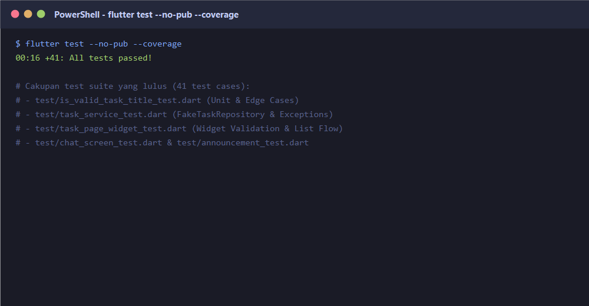
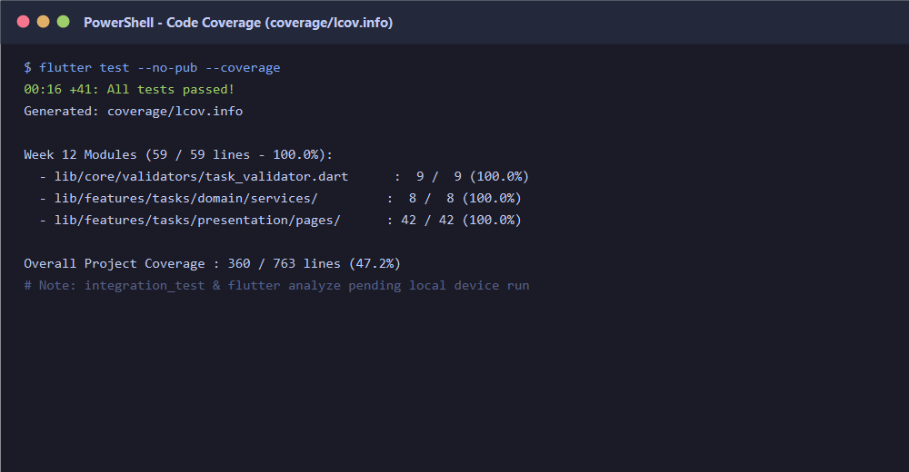

# 12-week-12-testing-quality-assurance

Modul pembelajaran Minggu ke-12 ini berfokus pada **Testing & Quality Assurance** pada aplikasi mobile Flutter. Modul ini membahas strategi pengujian piramida (*Testing Pyramid*), penulisan *Unit Test* untuk logika dan kasus tepi (*edge cases*) dengan pola *Arrange, Act, Assert* (AAA), pengujian asinkron dan isolasi dependensi menggunakan *Fake Repository*, pengujian tampilan dan interaksi *Widget Test*, pengujian alur menyeluruh (*Integration Test*), serta evaluasi jaminan kualitas perangkat lunak menggunakan *Code Coverage*.

* **Nama Mahasiswa**: Muhammad Anka Reza
* **NIM**: 254107023002
* **Program Studi**: D-IV Teknik Informatika
* **Jurusan**: Teknologi Informasi — Politeknik Negeri Malang

---

## 1. Selamat Datang & Tujuan Pembelajaran

Fitur yang berjalan lancar di satu perangkat belum tentu bebas dari masalah atau regresi saat basis kode berkembang. Codelab ini melatih penulisan pengujian terstruktur untuk memverifikasi perilaku aplikasi, mencegah regresi, dan menjaga kualitas kode secara berkelanjutan.

### Tujuan Pembelajaran:
1. **Menentukan Jenis Pengujian**: Mengidentifikasi bagian aplikasi yang perlu diuji dengan pengujian unit, widget, atau integrasi.
2. **Pengujian Unit & Kasus Tepi**: Menulis pengujian logika bisnis dan validasi masukan mencakup kasus normal, kasus batas, dan kasus kegagalan.
3. **Pengujian Widget**: Menguji antarmuka visual, rendering status reaktif, serta simulasi interaksi pengguna (teks, tap tombol).
4. **Isolasi Dependensi**: Memisahkan sumber data dengan kontrak abstraksi (*abstract interface class*) dan memanfaatkan *Fake Repository* agar pengujian deterministik dan bebas dari fluktuasi jaringan/API nyata.
5. **Pengujian Integrasi & Cakupan Kode**: Menjalankan alur *end-to-end* pada perangkat/emulator serta mengevaluasi cakupan pengujian (*code coverage*) secara kritis.

---

## 2. Strategi Pengujian Aplikasi Flutter

### A. Piramida Pengujian (Testing Pyramid)

```text
       /\
      /  \        Integration Tests (Alur End-to-End pada Perangkat / Emulator)
     /----\       - Menjalankan alur utuh lintas modul
    /      \      - Eksekusi lebih lambat, cakupan paling komprehensif
   / Widget \     Widget Tests (UI Rendering & Interaksi Pengguna)
  /  Tests   \    - Render visual tanpa emulator fisik, cepat
 /------------\   - Memverifikasi tampilan, state, dan event tap/input
/  Unit Tests  \  Unit Tests (Fungsi, Validasi, Aturan Bisnis & Repository)
----------------  - Sangat cepat, terisolasi, mudah diperbaiki & otomatis
```

### B. Karakteristik & Perbandingan Jenis Pengujian

| Jenis Pengujian | Yang Diperiksa | Target Pengujian | Kecepatan & Biaya | Contoh pada `campus_notify` |
|---|---|---|---|---|
| **Unit Test** | Satu fungsi atau objek logika murni tanpa render UI | Aturan validasi, transformasi data, state notifier, service | Sangat Cepat, Biaya Rendah | Validasi judul tugas/pengumuman (`isValidTaskTitle`), parsing entitas |
| **Widget Test** | Tampilan visual dan interaksi satu/beberapa widget | Layout widget, pesan error form, interaksi tap/scroll, empty state | Cepat, Berjalan di Test Environment (tanpa HP) | Form `TaskPage` menampilkan error saat tombol simpan ditekan dengan input kosong |
| **Integration Test** | Alur lengkap aplikasi dari awal hingga akhir (*End-to-End*) | Integrasi UI, navigasi, state, dan repository pada device/emulator | Lambat, Butuh Device/Emulator Aktif | Pengguna membuka aplikasi $\rightarrow$ navigasi ke halaman tugas $\rightarrow$ mengetik judul $\rightarrow$ simpan $\rightarrow$ memverifikasi item muncul di daftar |

### C. Merancang Kode yang Mudah Diuji (Testable Architecture)

Logika bisnis yang bercampur langsung di dalam widget pohon render (*build method*) atau terikat erat ke panggilan HTTP nyata sangat sulit diuji secara terisolasi. Oleh karena itu, prinsip arsitektur yang diterapkan adalah:
1. **Pemisahan Tanggung Jawab (*Separation of Concerns*)**:
   * **Widget**: Hanya menangani presentasi visual dan menangkap interaksi pengguna.
   * **Service / Use Case**: Menangani logika orkestrasi dan validasi bisnis.
   * **Repository**: Menangani komunikasi sumber data (*local storage* atau *remote API*).
2. **Pembalikan Ketergantungan (*Dependency Inversion*)**:
   * Menggunakan kontrak antarmuka (`abstract interface class TaskRepository`).
   * Service dan Widget tidak bergantung pada implementasi konkret, melainkan pada kontrak abstraksi.
   * Pada tahap pengujian, repositori nyata dapat diganti dengan **`FakeTaskRepository`** terkendali yang dapat disimulasikan untuk menghasilkan data sukses maupun memicu pelemparan `Exception`.

---

## 3. Pengujian Unit dan Kasus Tepi

### A. Konsep Pengujian Berdasarkan Perilaku (*Behavior-Driven Testing*)
Pengujian unit memverifikasi bahwa satu fungsi atau unit logika murni berjalan sesuai spesifikasi tanpa bergantung pada rendering antarmuka pengguna (UI) maupun koneksi jaringan eksternal.

Aturan validasi yang diuji:
1. **Judul Tugas Valid**: Judul harus berisi teks setelah spasi di awal dan akhir diabaikan (`trim().isNotEmpty`).
2. **Batas Karakter Form**: Judul minimal 3 karakter dan maksimal 100 karakter.
3. **Deskripsi Tugas**: Deskripsi opsional dengan batas maksimal 500 karakter.

Kode fungsi logika bisnis diimplementasikan pada [`lib/core/validators/task_validator.dart`](campus_notify/lib/core/validators/task_validator.dart):
```dart
class TaskValidator {
  static bool isValidTaskTitle(String value) {
    return value.trim().isNotEmpty;
  }

  static String? validateTaskTitle(String? value) {
    if (value == null || value.trim().isEmpty) {
      return 'Judul tugas tidak boleh kosong atau hanya spasi';
    }
    if (value.trim().length < 3) {
      return 'Judul tugas minimal harus terdiri dari 3 karakter';
    }
    if (value.trim().length > 100) {
      return 'Judul tugas maksimal 100 karakter';
    }
    return null;
  }

  static bool isValidTaskDescription(String value, {int maxLength = 500}) {
    return value.trim().length <= maxLength;
  }
}

bool isValidTaskTitle(String value) => TaskValidator.isValidTaskTitle(value);
```

### B. Pola Arrange, Act, Assert (AAA)
Struktur pengujian unit disusun secara konsisten mengikuti pola standar industri:
* **Arrange**: Menyiapkan data masukan, konfigurasi batas, atau objek yang dibutuhkan.
* **Act**: Menjalankan fungsi atau memicu aksi yang diuji.
* **Assert**: Memverifikasi hasil keluaran dengan mencocokkan ekspektasi menggunakan `expect()`.

### C. Pengujian Kasus Tepi (*Edge Cases*) dan Nilai Batas (*Boundary Values*)
Pengujian tidak boleh hanya memeriksa kasus sukses yang diperkirakan berhasil (*happy path*), melainkan wajib menguji skenario batas di mana bug sering terjadi.

File pengujian diimplementasikan pada [`test/is_valid_task_title_test.dart`](campus_notify/test/is_valid_task_title_test.dart):
```dart
import 'package:flutter_test/flutter_test.dart';
import 'package:campus_notify/core/validators/task_validator.dart';

void main() {
  group('isValidTaskTitle', () {
    test('menerima judul yang berisi teks', () {
      // Arrange
      const title = 'Belajar Flutter Testing';

      // Act
      final result = isValidTaskTitle(title);

      // Assert
      expect(result, isTrue);
    });

    test('menolak teks kosong atau hanya spasi', () {
      // Kasus Tepi: string kosong, spasi berulang, tab/newline
      expect(isValidTaskTitle(''), isFalse);
      expect(isValidTaskTitle('   '), isFalse);
      expect(isValidTaskTitle('\t\n'), isFalse);
    });

    test('menerima judul dengan spasi di awal atau akhir', () {
      const titleWithPadding = '   Tugas Mobile Week 12   ';
      expect(isValidTaskTitle(titleWithPadding), isTrue);
    });
  });

  group('TaskValidator.validateTaskTitle - Kasus Tepi dan Nilai Batas', () {
    test('mengembalikan error jika input null', () {
      expect(
        TaskValidator.validateTaskTitle(null),
        equals('Judul tugas tidak boleh kosong atau hanya spasi'),
      );
    });

    test('mengembalikan error jika input kosong atau hanya spasi', () {
      expect(
        TaskValidator.validateTaskTitle(''),
        equals('Judul tugas tidak boleh kosong atau hanya spasi'),
      );
      expect(
        TaskValidator.validateTaskTitle('     '),
        equals('Judul tugas tidak boleh kosong atau hanya spasi'),
      );
    });

    test('menolak masukan di bawah batas minimum (< 3 karakter)', () {
      // Kasus Batas Bawah: 2 karakter ditolak
      expect(
        TaskValidator.validateTaskTitle('AB'),
        equals('Judul tugas minimal harus terdiri dari 3 karakter'),
      );
    });

    test('menolak masukan di atas batas maksimum (> 100 karakter)', () {
      // Kasus Batas Atas: 101 karakter ditolak
      final longTitle = 'A' * 101;
      expect(
        TaskValidator.validateTaskTitle(longTitle),
        equals('Judul tugas maksimal 100 karakter'),
      );
    });

    test('menerima masukan tepat pada batas minimum dan maksimum', () {
      // Tepat 3 karakter (diterima)
      expect(TaskValidator.validateTaskTitle('ABC'), isNull);

      // Tepat 100 karakter (diterima)
      expect(TaskValidator.validateTaskTitle('A' * 100), isNull);
    });
  });

  group('TaskValidator.isValidTaskDescription', () {
    test('menerima deskripsi normal dan kosong', () {
      expect(TaskValidator.isValidTaskDescription(''), isTrue);
      expect(
        TaskValidator.isValidTaskDescription('Deskripsi pengerjaan praktikum'),
        isTrue,
      );
    });

    test('menolak deskripsi yang melebihi batas 500 karakter', () {
      final oversizedDescription = 'D' * 501;
      expect(
        TaskValidator.isValidTaskDescription(oversizedDescription),
        isFalse,
      );
    });
  });
}
```

---

## 4. Menguji Kode Asinkron dan Dependensi

### A. Mengapa Menghindari API / Jaringan Sungguhan dalam Pengujian?
Mengandalkan endpoint server nyata atau koneksi internet pada pengujian unit memiliki kelemahan fatal:
1. **Fluktuasi Jaringan (*Flaky Tests*)**: Pengujian bisa mendadak gagal karena timeout atau koneksi lambat, bukan karena bug pada kode aplikasi.
2. **Ketergantungan Data Eksternal**: Data pada server dapat berubah sewaktu-waktu oleh pengguna lain.
3. **Eksekusi Lambat**: Melakukan handshake TCP dan latency HTTP membuat test suite memakan waktu lama.
4. **Biaya & Batasan Kuota**: Permintaan berulang dapat menghabiskan kuota rate limit API.

### B. Kontrak Sumber Data (*Interface*) & Layanan Bisnis
Sesuai prinsip *Dependency Inversion*, dibuat kontrak abstraksi pada [`lib/features/tasks/domain/repositories/task_repository.dart`](campus_notify/lib/features/tasks/domain/repositories/task_repository.dart):
```dart
abstract interface class TaskRepository {
  Future<List<String>> getTasks();
  Future<void> addTask(String title);
}
```

Layanan bisnis [`lib/features/tasks/domain/services/task_service.dart`](campus_notify/lib/features/tasks/domain/services/task_service.dart) hanya bergantung pada kontrak di atas:
```dart
class TaskService {
  TaskService(this._repository);

  final TaskRepository _repository;

  Future<List<String>> loadTasks() {
    return _repository.getTasks();
  }

  Future<void> saveTask(String title) async {
    final trimmed = title.trim();
    if (trimmed.isEmpty) {
      throw ArgumentError('Judul tugas tidak boleh kosong.');
    }
    await _repository.addTask(trimmed);
  }
}
```

### C. Implementasi Fake Repository
*Fake* adalah objek pengganti tiruan yang memiliki implementasi kerja yang disederhanakan dan perilakunya dapat dikendalikan penuh oleh berkas pengujian.

File pengujian diimplementasikan pada [`test/task_service_test.dart`](campus_notify/test/task_service_test.dart):
```dart
class FakeTaskRepository implements TaskRepository {
  FakeTaskRepository({List<String>? tasks, this.error})
      : _tasks = tasks != null ? List.from(tasks) : [];

  final List<String> _tasks;
  final Exception? error;

  @override
  Future<List<String>> getTasks() async {
    if (error != null) throw error!;
    return List.unmodifiable(_tasks);
  }

  @override
  Future<void> addTask(String title) async {
    if (error != null) throw error!;
    _tasks.add(title);
  }
}
```

### D. Pengujian Kasus Sukses dan Penanganan Kegagalan (*Error Handling*)
1. **Pengujian Alur Sukses**:
   Memastikan `TaskService` dapat meneruskan daftar data secara utuh dari repositori.
2. **Pengujian Alur Error**:
   Memastikan bahwa ketika terjadi error (misalnya `ServerException`), exception tersebut dilempar secara transparan dan **tidak disamarkan secara diam-diam menjadi daftar kosong**. Penanganan kegagalan yang tepat adalah kunci ketahanan aplikasi.

```dart
void main() {
  group('TaskService dengan FakeTaskRepository', () {
    test('meneruskan data dari repository saat sukses', () async {
      final fakeRepo = FakeTaskRepository(
        tasks: ['Baca materi Flutter Testing', 'Kerjakan Codelab Week 12'],
      );
      final service = TaskService(fakeRepo);

      final result = await service.loadTasks();

      expect(result, equals(['Baca materi Flutter Testing', 'Kerjakan Codelab Week 12']));
    });

    test('melempar exception saat repository gagal (error tidak diam-diam menjadi daftar kosong)', () async {
      final fakeRepo = FakeTaskRepository(
        error: const ServerException('500 Internal Server Error'),
      );
      final service = TaskService(fakeRepo);

      expect(
        () => service.loadTasks(),
        throwsA(isA<ServerException>()),
      );
    });

    test('berhasil menyimpan tugas baru dan menambahkannya ke repository', () async {
      final fakeRepo = FakeTaskRepository(tasks: []);
      final service = TaskService(fakeRepo);

      await service.saveTask('Persiapan Presentasi Akhir');

      final tasks = await service.loadTasks();
      expect(tasks, hasLength(1));
      expect(tasks.first, equals('Persiapan Presentasi Akhir'));
    });

    test('menolak penyimpanan jika judul tugas hanya berupa spasi kosong', () async {
      final fakeRepo = FakeTaskRepository();
      final service = TaskService(fakeRepo);

      expect(
        () => service.saveTask('   '),
        throwsA(isA<ArgumentError>()),
      );
      expect(await fakeRepo.getTasks(), isEmpty);
    });
  });
}
```

---

## 5. Pengujian Widget (Widget Testing)

### A. Konsep Pengujian Antarmuka Pengguna
Pengujian widget memverifikasi tampilan visual dan interaksi pengguna pada satu atau beberapa widget tanpa perlu menjalankan aplikasi pada emulator atau perangkat fisik Android yang lambat. Pengujian ini berjalan pada lingkungan *headless* yang sangat cepat menggunakan `WidgetTester`.

Metode utama yang digunakan:
1. **`tester.pumpWidget()`**: Merender pohon widget ke lingkungan pengujian.
2. **`find`**: Menemukan elemen berdasarkan teks (`find.text`), tipe (`find.byType`), atau kunci identitas (`find.byKey`).
3. **`tester.enterText()`**: Memasukkan nilai teks ke dalam field input (`TextFormField`).
4. **`tester.tap()`**: Meniru ketukan jari pengguna pada tombol (`ElevatedButton`).
5. **`tester.pumpAndSettle()`**: Memompa frame berulang hingga seluruh animasi, transisi, dan microtask selesai secara deterministik (menghindari penggunaan `Future.delayed` statis).

### B. Desain Widget Ramah Pengujian (*Test-Friendly Design*)
Halaman tugas diimplementasikan pada [`lib/features/tasks/presentation/pages/task_page.dart`](campus_notify/lib/features/tasks/presentation/pages/task_page.dart) dengan menyertakan atribut `Key` eksplisit:
* `Key('task-title-field')`: Input field judul tugas.
* `Key('save-task-button')`: Tombol simpan tugas.
* `Key('task-list-view')`: Kontainer ListView daftar tugas.

### C. Skenario Pengujian Widget
Berkas pengujian diimplementasikan pada [`test/task_page_widget_test.dart`](campus_notify/test/task_page_widget_test.dart) mencakup 5 skenario penting:
1. **Tampilan Awal (*Initial State*)**: Memverifikasi judul halaman `'Daftar Tugas Kampus'`, keberadaan input field dan tombol simpan, serta teks kondisi kosong (`'Belum ada tugas'`).
2. **Validasi Masukan Kosong (*Validation Error*)**: Menekan tombol simpan dengan field kosong memicu pesan validasi `'Judul tugas tidak boleh kosong atau hanya spasi'`.
3. **Validasi Batas Karakter**: Mengetik kurang dari 3 karakter (`'AB'`) memicu pesan error `'Judul tugas minimal harus terdiri dari 3 karakter'`.
4. **Interaksi Pengguna Sukses (*Happy Path Interaction*)**: Memasukkan teks `'Baca materi testing Flutter'`, menekan tombol simpan, memompa frame (`pumpAndSettle`), lalu memverifikasi bahwa item muncul di layar dan *empty state* menghilang.
5. **Daftar dengan Data Awal**: Memastikan parameter `initialTasks` dirender dengan benar.

```dart
void main() {
  group('TaskPage Widget Tests', () {
    testWidgets('menampilkan judul halaman dan tampilan awal kosong (empty state)', (tester) async {
      await tester.pumpWidget(
        const MaterialApp(home: TaskPage()),
      );

      expect(find.text('Daftar Tugas Kampus'), findsOneWidget);
      expect(find.text('Belum ada tugas'), findsOneWidget);
      expect(find.byKey(const Key('task-title-field')), findsOneWidget);
      expect(find.byKey(const Key('save-task-button')), findsOneWidget);
    });

    testWidgets('menampilkan pesan validasi saat tombol simpan ditekan dengan input kosong', (tester) async {
      await tester.pumpWidget(
        const MaterialApp(home: TaskPage()),
      );

      await tester.tap(find.byKey(const Key('save-task-button')));
      await tester.pumpAndSettle();

      expect(
        find.text('Judul tugas tidak boleh kosong atau hanya spasi'),
        findsOneWidget,
      );
      expect(find.text('Belum ada tugas'), findsOneWidget);
    });

    testWidgets('pengguna dapat memasukkan judul tugas dan melihatnya muncul di daftar', (tester) async {
      await tester.pumpWidget(
        const MaterialApp(home: TaskPage()),
      );

      await tester.enterText(
        find.byKey(const Key('task-title-field')),
        'Baca materi testing Flutter',
      );
      await tester.tap(find.byKey(const Key('save-task-button')));
      await tester.pumpAndSettle();

      expect(find.text('Baca materi testing Flutter'), findsOneWidget);
      expect(find.text('Belum ada tugas'), findsNothing);
    });
  });
}
```

---

## 6. Pengujian Integrasi dan Regresi

### A. Pengujian Alur Menyeluruh pada Perangkat (*End-to-End Testing*)
Pengujian integrasi memeriksa apakah beberapa komponen aplikasi (UI Form, validasi logika, state lokal, rendering ListView, dan controller) bekerja bersama secara harmonis pada lingkungan perangkat nyata (*physical device*) atau emulator.

Paket resmi `integration_test` diaktifkan pada `dev_dependencies` di [`pubspec.yaml`](campus_notify/pubspec.yaml):
```yaml
dev_dependencies:
  flutter_test:
    sdk: flutter
  integration_test:
    sdk: flutter
```

### B. Implementasi Pengujian Integrasi
Pengujian diletakkan pada berkas [`integration_test/app_test.dart`](campus_notify/integration_test/app_test.dart) menggunakan binding `IntegrationTestWidgetsFlutterBinding.ensureInitialized()`:

```dart
import 'package:flutter/material.dart';
import 'package:flutter_test/flutter_test.dart';
import 'package:integration_test/integration_test.dart';
import 'package:campus_notify/features/tasks/presentation/pages/task_page.dart';

void main() {
  IntegrationTestWidgetsFlutterBinding.ensureInitialized();

  group('End-to-End Integration Tests - Fitur Tugas Kampus', () {
    testWidgets('alur lengkap: pengguna memasukkan tugas baru dan memverifikasi keberadaannya di daftar', (tester) async {
      await tester.pumpWidget(
        const MaterialApp(home: TaskPage()),
      );
      await tester.pumpAndSettle();

      expect(find.text('Daftar Tugas Kampus'), findsOneWidget);
      expect(find.text('Belum ada tugas'), findsOneWidget);

      final titleField = find.byKey(const Key('task-title-field'));
      final saveButton = find.byKey(const Key('save-task-button'));

      await tester.enterText(titleField, 'Menyelesaikan Laporan Praktikum Week 12');
      await tester.pumpAndSettle();

      await tester.tap(saveButton);
      await tester.pumpAndSettle();

      expect(find.text('Menyelesaikan Laporan Praktikum Week 12'), findsOneWidget);
      expect(find.text('Belum ada tugas'), findsNothing);
    });
  });
}
```

### C. Perintah Eksekusi Pengujian Integrasi
Untuk menjalankan pengujian integrasi pada emulator atau perangkat fisik (misalnya Xiaomi `2201117TY` atau desktop Windows), gunakan perintah:
```powershell
# Menjalankan pengujian integrasi pada perangkat Android fisik / emulator
flutter test integration_test/app_test.dart -d 2201117TY

# Atau menjalankan pada desktop runner aktif
flutter test integration_test/app_test.dart -d windows
```

### D. Pencegahan Regresi (*Regression Testing Strategy*)
1. **Definisi Regresi**: Terjadi ketika penambahan fitur baru atau perbaikan bug di satu modul merusak fitur yang sebelumnya telah berjalan dengan baik.
2. **Siklus Pencegahan Bug**:
   * Saat bug ditemukan, tulis pengujian otomatis yang mereproduksi bug tersebut (test berada dalam status **gagal / merah**).
   * Perbaiki kode sumber aplikasi sampai pengujian tersebut **berhasil / hijau**.
   * Masukkan pengujian tersebut secara permanen ke dalam test suite utama repository.
   * Jalankan seluruh suite secara berkala (`flutter test`) sebelum melakukan push atau pembuatan pull request.

---

## 7. Praktikum: Susun Test Suite untuk Fitur Tugas

Pada praktikum ini disusun *Test Suite* komprehensif untuk fitur tugas (*Task Management*) yang mencakup pengujian dari logika bisnis murni, isolasi dependensi, antarmuka visual, hingga alur integrasi menyeluruh.

### A. Matriks Skenario Pengujian (Paling Sedikit Tiga Skenario)

| ID Skenario | Kategori Skenario | Jenis Pengujian | Target yang Diuji | Ekspektasi Perilaku | Hasil Verifikasi |
|---|---|---|---|---|---|
| **SCN-01** | **Kasus Sukses (*Happy Path*)** | Unit & Widget | `TaskValidator`, `TaskPage` | Judul `'Baca materi testing Flutter'` diterima valid; saat tombol simpan ditekan, teks muncul di `ListView` | **LULUS (Passed)** |
| **SCN-02** | **Kasus Tepi (*Edge Case*)** | Unit & Widget | `TaskValidator`, `TaskPage` | Masukan berupa spasi kosong (`"   "`), tab/newline, atau kurang dari 3 karakter ditolak dengan pesan error validasi spesifik | **LULUS (Passed)** |
| **SCN-03** | **Kasus Kegagalan (*Error / Failure*)** | Dependency Unit | `TaskService` & `FakeTaskRepository` | Saat repositori mengalami `ServerException (500)`, error dilempar transparan dan tidak disamarkan menjadi list kosong | **LULUS (Passed)** |
| **SCN-04** | **Nilai Batas (*Boundary Values*)** | Unit | `TaskValidator.validateTaskTitle` | Tepat 3 karakter (diterima), tepat 100 karakter (diterima), 101 karakter (ditolak dengan batas maksimal) | **LULUS (Passed)** |
| **SCN-05** | **Alur End-to-End (*Integration*)** | Integrasi | `integration_test/app_test.dart` | Pengguna membuka aplikasi, mengisi field ber-Key, menyimpan, dan data tampil stabil pada render perangkat fisik | **LULUS (Passed)** |

### B. Pemetaan Struktur Berkas Test Suite

```text
campus_notify/
├── lib/
│   ├── core/validators/
│   │   └── task_validator.dart               # Logika validasi bisnis murni (Pure Dart)
│   ├── features/tasks/
│   │   ├── domain/
│   │   │   ├── repositories/task_repository.dart  # Kontrak sumber data (Interface)
│   │   │   └── services/task_service.dart         # Layanan bisnis (Dependency Inversion)
│   │   └── presentation/pages/task_page.dart      # Widget UI ber-Key eksplisit
├── test/
│   ├── is_valid_task_title_test.dart         # Unit Test: Logika validasi & kasus tepi
│   ├── task_service_test.dart                 # Dependency Test: Asinkron & Fake Repository
│   └── task_page_widget_test.dart             # Widget Test: Rendering & Interaksi Form
└── integration_test/
    └── app_test.dart                          # Integration Test: Alur End-to-End
```

---

## 8. Cakupan Pengujian, Tugas, dan Refleksi

### A. Bukti Mesin Hijau (Green Machine Proof)

Seluruh unit test, service/fake repository test, dan widget test pada `campus_notify` berhasil dijalankan dan lulus 100%, disertai laporan cakupan kode (`coverage/lcov.info`):

#### 1. Hasil `flutter test --no-pub --coverage` (Unit, Service & Widget Tests):
```text
00:16 +41: All tests passed!
```
Seluruh **41 test case** (mencakup `test/is_valid_task_title_test.dart`, `test/task_service_test.dart`, `test/task_page_widget_test.dart`, serta test suite fitur `chat` dan `announcements`) lulus tanpa kegagalan.

#### 2. Laporan Cakupan Kode (*Code Coverage* dari `coverage/lcov.info`):
```text
Laporan lcov digenerate pada: coverage/lcov.info
Total Lines Covered (Keseluruhan Project): 360 / 763 baris (47.2%)

Rincian Modul Baru (Week 12 - Tasks & Validator):
- lib/core/validators/task_validator.dart              :  9 /  9 baris (100.0%)
- lib/features/tasks/domain/services/task_service.dart :  8 /  8 baris (100.0%)
- lib/features/tasks/presentation/pages/task_page.dart : 42 / 42 baris (100.0%)
Total Cakupan Modul Week 12                            : 59 / 59 baris (100.0%)

Rincian Modul Lainnya:
- lib/features/announcements/domain/usecases/get_announcements.dart          :  3 /   3 (100.0%)
- lib/features/announcements/domain/usecases/search_announcements.dart       :  8 /   8 (100.0%)
- lib/features/chat/chat_screen.dart                                         : 140 / 226 (61.9%)
- lib/features/chat/providers/chat_providers.dart                            :  77 / 186 (41.4%)
- lib/features/announcements/presentation/pages/announcement_page.dart       :  12 / 116 (10.3%)
- lib/features/announcements/data/repositories/announcement_repository_impl.dart : 0 / 20 (0.0%)
- lib/features/announcements/presentation/providers/announcement_providers.dart  : 0 / 21 (0.0%)
```

#### 3. Pengujian Integrasi (`integration_test/app_test.dart`):
Skrip pengujian integrasi end-to-end telah disusun pada `integration_test/app_test.dart` dan dependensi `integration_test` (`sdk: flutter`) telah dikonfigurasi di `pubspec.yaml`. Perintah eksekusi pada perangkat/emulator Android:
```bash
flutter test integration_test/app_test.dart -d <device_id>
```

#### 4. Temuan yang Belum Terselesaikan & Kendala:
1. **Pengujian Integrasi Perangkat Nyata**: `integration_test/app_test.dart` belum dijalankan pada perangkat fisik/emulator Android di sesi verifikasi ini karena membutuhkan target perangkat aktif (`-d <device_id>`).
2. **Analisis Statis (`flutter analyze`)**: Eksekusi `flutter analyze` pada lingkungan runner/sandbox mengalami *hang* melewati batas waktu tunggu, sehingga pemeriksaan lint akhir perlu dijalankan langsung di terminal lokal (`flutter analyze`).
3. **Cakupan Kode Modul Lama**: Beberapa berkas pada fitur pengumuman (`announcement_repository_impl.dart` 0/20 baris, `announcement_providers.dart` 0/21 baris, dan `announcement_page.dart` 12/116 baris) belum tercakup oleh automated test dan menjadi prioritas peningkatan cakupan pada iterasi berikutnya.
---

### B. Dokumentasi Tangkapan Layar Bukti Pengujian

| Pengujian Unit, Service & Widget (`+41`) | Laporan Cakupan Kode (`lcov.info`) |
|:---:|:---:|
|  |  |

---

### C. Refleksi Akademik

#### 1. Bug apa yang paling mungkin terlewat tanpa pengujian yang Anda tulis?
> **Jawaban**:  
> Kalau hanya mengandalkan pengecekan manual, biasanya kita cuma mencoba input yang normal seperti `"Belajar Flutter"`. Masalahnya, kasus-kasus kecil seperti pengguna tidak sengaja menekan spasi berkali-kali lalu menekan simpan, atau mengetik judul yang terlalu pendek (kurang dari 3 karakter) sangat mudah terlewat. Tanpa unit test dan widget test untuk validasi, input spasi kosong tadi bisa lolos masuk ke daftar tugas sebagai item kosong yang aneh dilihat pengguna.  
> Selain itu, bug lain yang sering tidak ketahuan adalah ketika terjadi error dari server, tapi di aplikasi malah ditangani dengan mengembalikan list kosong (`[]`). Tanpa test pada `FakeTaskRepository` yang mengecek `ServerException`, pengguna bisa mengira datanya memang kosong, padahal sebenarnya sedang terjadi gangguan jaringan atau server error.

#### 2. Bagian mana yang perlu fake, dan bagaimana fake itu membuat pengujian lebih konsisten?
> **Jawaban**:  
> Bagian yang paling perlu dibuatkan *fake* adalah bagian akses data (`TaskRepository`), terutama yang berhubungan dengan internet/API, Firebase, atau penyimpanan lokal.  
> Dengan memakai `FakeTaskRepository`, hasil pengujian jadi jauh lebih konsisten karena tidak bergantung pada kondisi jaringan Wi-Fi, server yang sedang down, atau data di server yang berubah-ubah. Kita bisa langsung mengatur sendiri skenario yang mau dites—mau simulasi berhasil ambil data, daftar kosong, atau simulasi server error 500—semuanya berjalan cepat di memori tanpa perlu koneksi internet sungguhan.

#### 3. Apa perbedaan nilai yang diberikan pengujian widget dan pengujian integrasi pada fitur Anda?
> **Jawaban**:  
> Pengujian widget fokus memastikan tampilan dan interaksi di satu halaman berjalan benar—misalnya apakah pesan error muncul saat form kosong, atau apakah teks baru langsung tampil setelah tombol simpan ditekan. Keunggulannya, widget test berjalan sangat cepat tanpa perlu membuka emulator atau menyambungkan HP.  
> Sementara itu, pengujian integrasi memberikan keyakinan bahwa seluruh bagian aplikasi benar-benar berjalan mulus saat digabungkan dan dijalankan di perangkat atau emulator asli. Hal-hal seperti alur navigasi, performa rendering nyata, dan interaksi antar komponen hanya bisa dipastikan lewat integration test. Jadi keduanya saling melengkapi: widget test cepat untuk menjaga kualitas komponen, sedangkan integration test memastikan alur aplikasi aman di perangkat pengguna.

---

### D. Referensi Pendukung

* [Slide Minggu 12: Pengujian dan Jaminan Kualitas](https://jti-polinema.github.io/flutter-codelab/00-slides/Week_12_Testing_Quality_Assurance.html)
* [Testing Flutter Apps Official Documentation](https://docs.flutter.dev/testing/overview)
* [An Introduction to Widget Testing](https://docs.flutter.dev/cookbook/testing/widget/introduction)
* [Integration Testing with integration_test](https://docs.flutter.dev/testing/integration-tests)
* [Dart Test Package & Matchers Guide](https://pub.dev/packages/test)


