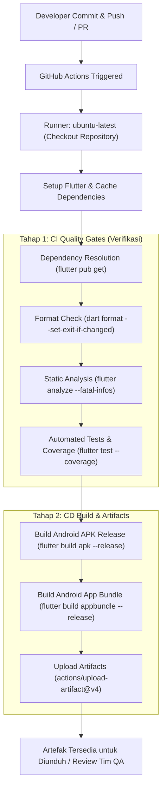
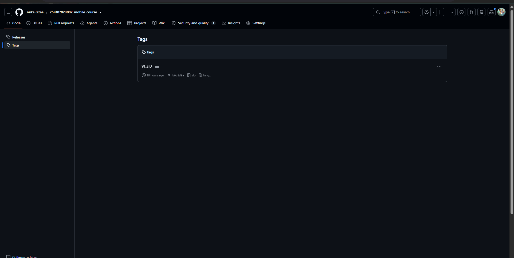
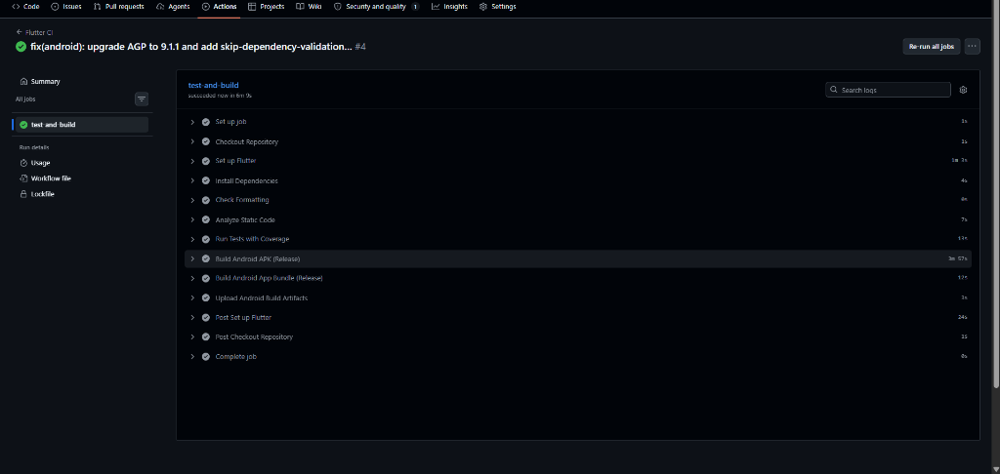
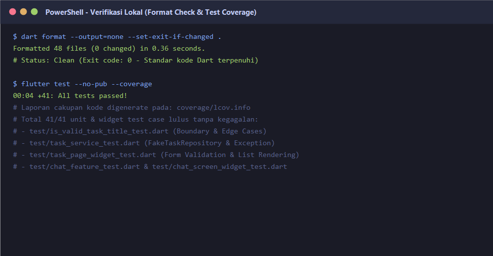
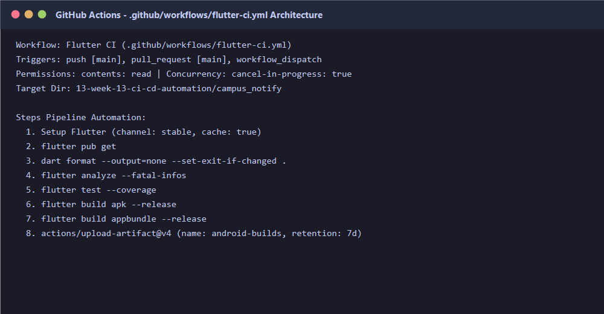

# 13-week-13-ci-cd-automation

Modul pembelajaran Minggu ke-13 ini berfokus pada **CI/CD dan Otomatisasi (CI/CD Automation)** pada ekosistem aplikasi mobile Flutter. Modul ini membahas perancangan dan implementasi pipeline *Continuous Integration* (CI) dan *Continuous Delivery* (CD) menggunakan **GitHub Actions** untuk menjalankan pemeriksaan format kode, analisis statis, pengujian unit dan widget otomatis, kalkulasi cakupan kode (*code coverage*), kompilasi binary Android (*release* APK dan AAB), serta penyimpanan artefak rilis. Selain itu, modul ini mengevaluasi strategi penomoran rilis (*Semantic Versioning*) dan manajemen keamanan rahasia (*secrets management*).

* **Nama Mahasiswa**: Muhammad Anka Reza
* **NIM**: 254107023002
* **Program Studi**: D-IV Teknik Informatika
* **Jurusan**: Teknologi Informasi — Politeknik Negeri Malang
* **Mata Kuliah**: Pemrograman Mobile

---

## 1. Selamat Datang & Tujuan Pembelajaran

Pemeriksaan manual yang dilakukan berulang kali oleh pengembang sangat rentan terhadap kelalaian manusia (*human error*), memakan waktu, dan sulit direproduksi secara konsisten di berbagai lingkungan kerja. Melalui codelab ini, pipeline otomatisasi dibangun menggunakan GitHub Actions untuk menjamin setiap baris kode yang masuk ke branch utama telah teruji, terformat rapi, dan terbebas dari kesalahan analisis statis.

### Tujuan Pembelajaran:
1. **Menjelaskan Alur CI/CD**: Memahami siklus hidup dari commit pengembang hingga menghasilkan artefak aplikasi yang siap diuji atau didistribusikan.
2. **Membangun Workflow Otomasi**: Menyusun berkas alur kerja GitHub Actions untuk format kode (`dart format`), analisis statis (`flutter analyze`), pengujian otomatis (`flutter test`), dan build Android.
3. **Penyimpanan Artefak Rilis**: Mengonfigurasi penyimpanan APK (*Android Package Kit*) dan AAB (*Android App Bundle*) menggunakan `actions/upload-artifact@v4`.
4. **Penerapan Versioning & Secrets Management**: Mengelola penomoran versi sesuai prinsip *Semantic Versioning*, memahami batas keamanan kompilasi `--dart-define`, serta mengamankan kredensial penandatanganan aplikasi (*keystore*).

---

## 2. Memahami CI/CD dan Alur Kerja

### A. Konsep Dasar CI dan CD
* **Continuous Integration (CI)**: Praktik pengembang untuk mengintegrasikan kode ke repository bersama secara teratur. Setiap integrasi diverifikasi secara otomatis melalui pembacaan kode, pemeriksaan dependensi, validasi format, analisis statis, dan eksekusi test suite. Tujuannya adalah mendeteksi *bug* atau konflik sedini mungkin.
* **Continuous Delivery / Continuous Deployment (CD)**: Praktik lanjutan setelah tahap CI lulus, di mana aplikasi otomatis dikompilasi ke dalam paket rilis (*release build*) dan disimpan sebagai artefak atau diteruskan ke lingkungan staging/produksi (misalnya Google Play Internal Testing Track).



### B. Event Trigger, Permissions, dan Concurrency Control
1. **Event Trigger**:
   - `push`: Memeriksa stabilitas branch utama (`main`) setiap kali ada commit yang di-merge.
   - `pull_request`: Menguji branch fitur sebelum diizinkan untuk di-merge ke branch `main`.
   - `workflow_dispatch`: Memungkinkan eksekusi manual langsung dari antarmuka web GitHub Actions.
2. **Prinsip Hak Akses Minimum (*Least Privilege*)**:
   - Menggunakan `permissions: contents: read` untuk memastikan runner CI hanya memiliki akses baca terhadap source code repository, mencegah modifikasi repositori yang tidak disengaja atau celah eksploitasi dependensi pihak ketiga.
3. **Concurrency & Pembatalan Otomatis**:
   - Dikonfigurasi dengan `cancel-in-progress: true` di bawah grup alur kerja `${{ github.workflow }}-${{ github.ref }}`. Jika pengembang melakukan push commit baru saat workflow lama masih berjalan, run sebelumnya otomatis dibatalkan untuk menghemat kuota runner GitHub.

---

## 3. Konfigurasi Workflow GitHub Actions

Berkas konfigurasi diletakkan di root repositori pada [`.github/workflows/flutter-ci.yml`](file:///c:/laragon/www/254107023002-mobile-course/254107023002-mobile-course/.github/workflows/flutter-ci.yml).

### A. Penyesuaian Struktur Monorepo
Karena repositori ini menyimpan materi perkuliahan per minggu dalam subdirektori tersendiri, seluruh perintah `run` diarahkan ke direktori proyek aktif menggunakan:
```yaml
defaults:
  run:
    working-directory: 13-week-13-ci-cd-automation/campus_notify
```
Hal ini memastikan perintah seperti `flutter pub get` dan `flutter test` dieksekusi tepat pada paket aplikasi Flutter tanpa mengganggu folder minggu lainnya.

### B. Isi Lengkap `.github/workflows/flutter-ci.yml`

```yaml
name: Flutter CI

on:
  push:
    branches: [main]
  pull_request:
    branches: [main]
  workflow_dispatch:

permissions:
  contents: read

concurrency:
  group: ${{ github.workflow }}-${{ github.ref }}
  cancel-in-progress: true

jobs:
  test-and-build:
    runs-on: ubuntu-latest
    defaults:
      run:
        working-directory: 13-week-13-ci-cd-automation/campus_notify
    steps:
      - name: Checkout Repository
        uses: actions/checkout@v4

      - name: Set up Flutter
        uses: subosito/flutter-action@v2
        with:
          channel: stable
          cache: true

      - name: Install Dependencies
        run: flutter pub get

      - name: Check Formatting
        run: dart format --output=none --set-exit-if-changed .

      - name: Analyze Static Code
        run: flutter analyze --fatal-infos

      - name: Run Tests with Coverage
        run: flutter test --coverage

      - name: Build Android APK (Release)
        run: flutter build apk --release

      - name: Build Android App Bundle (Release)
        run: flutter build appbundle --release

      - name: Upload Android Build Artifacts
        uses: actions/upload-artifact@v4
        with:
          name: android-builds
          path: |
            13-week-13-ci-cd-automation/campus_notify/build/app/outputs/flutter-apk/app-release.apk
            13-week-13-ci-cd-automation/campus_notify/build/app/outputs/bundle/release/app-release.aab
          if-no-files-found: error
          retention-days: 7
```

---

## 4. Membangun dan Menyimpan Artefak APK & AAB

### A. Perbedaan Format APK dan AAB

| Kriteria | Android Package Kit (APK) | Android App Bundle (AAB) |
|---|---|---|
| **Perintah Build** | `flutter build apk --release` | `flutter build appbundle --release` |
| **Output File** | `build/app/outputs/flutter-apk/app-release.apk` | `build/app/outputs/bundle/release/app-release.aab` |
| **Target Penggunaan** | Pengujian langsung pada HP fisik, QA internal, sideloading, atau distribusi mandiri | Format resmi Google Play Store untuk publikasi publik |
| **Kelebihan** | Dapat langsung diinstal dengan `adb install` tanpa perantara | Google Play Dynamic Delivery mengoptimalkan ukuran download per arsitektur CPU dan densitas layar perangkat pengguna |

### B. Penyimpanan Artefak (`actions/upload-artifact@v4`)
* **Retention Days**: Ditetapkan selama **7 hari** guna mencegah konsumsi penyimpanan penyimpanan akun GitHub yang berlebihan.
* **Error Handling**: Opsi `if-no-files-found: error` disematkan agar alur kerja langsung gagal jika salah satu file binary tidak berhasil terbentuk.
* **Akses Unduhan**: Pengembang dan tim QA dapat mengunduh zip paket `android-builds` langsung melalui ringkasan *Workflow Run Summary* di tab Actions GitHub.

---

## 5. Versi, Secrets, dan Keamanan

### A. Penerapan Semantic Versioning (SemVer)
Pada [`pubspec.yaml`](file:///c:/laragon/www/254107023002-mobile-course/254107023002-mobile-course/13-week-13-ci-cd-automation/campus_notify/pubspec.yaml), versi aplikasi dikonfigurasi mengikuti format `MAJOR.MINOR.PATCH+BUILD_NUMBER`:

```yaml
version: 1.3.0+13
```
* **`1` (MAJOR)**: Versi arsitektural utama.
* **`3` (MINOR)**: Penambahan fitur baru yang *backward-compatible* (fitur otomatisasi CI/CD & build packaging).
* **`0` (PATCH)**: Perbaikan *bug* atau optimasi kecil tanpa perubahan fungsionalitas besar.
* **`+13` (BUILD NUMBER)**: Nilai bilangan bulat inkremental yang digunakan Android sebagai `versionCode` untuk membedakan urutan rilis di Google Play Store.

### B. Git Tagging untuk Rilis
Setiap commit rilis yang berhasil lolos pipeline CI ditandai dengan Git Tag:
```bash
git tag -a v1.3.0 -m "Release v1.3.0: CI/CD Pipeline Automation & Multi-Artifact Build"
git push origin v1.3.0
```
Tag rilis `v1.3.0` telah berhasil dibuat dan terunggah pada remote GitHub:


### C. Analisis Risiko Keamanan & Manajemen Rahasia (*Secrets Management*)

1. **Keterbatasan `--dart-define`**:
   - Nilai konfigurasi yang dimasukkan melalui parameter `--dart-define` (misalnya `--dart-define=API_URL=...`) dikompilasi langsung ke dalam binary APK/AAB klien.
   - String tersebut dapat diekstraksi dengan mudah menggunakan alat *reverse engineering* seperti `apktool`, `jadx`, atau perintah `strings`. Oleh karena itu, `--dart-define` hanya boleh digunakan untuk konfigurasi lingkungan publik (misal URL server staging/prod), dan **bukan untuk private API key, token master, atau password**.
2. **Keamanan Keystore dan Kredensial Signing**:
   - File *keystore* (`.jks` / `.keystore`) dan kata sandinya tidak boleh dimasukkan ke dalam repositori Git publik.
   - Pada alur produksi sesungguhnya, file keystore di-encode dalam bentuk Base64 dan disimpan di **GitHub Actions Secrets**. Pada workflow rilis khusus (yang hanya aktif saat tag rilis dibuat), keystore didekode ke disk runner secara temporer dan langsung dihapus setelah build selesai.
   - Keystore produksi **tidak boleh digunakan pada workflow pull request** guna menghindari kebocoran kredensial dari fork kontributor yang tidak terpercaya.

### D. Dokumentasi Tugas Codelab: Versi Berikutnya, Pemeriksaan yang Dijalankan, & Risiko Keamanan

Secara eksplisit, tabel berikut merangkum 3 poin penugasan utama sesuai panduan codelab Minggu 13:

#### 1. Rencana Versi Berikutnya (*Next Versioning Roadmap*)
* **Versi Saat Ini**: `1.3.0+13` (Rilis Week 13 — Otomasi CI/CD & Build APK/AAB).
* **Rencana Rilis Mendatang**:
  * **`v1.3.1+14` (Patch Version)**: Digunakan jika terdapat perbaikan *bug* kecil, update patch dependensi keamanan, atau penyesuaian styling tanpa merubah fungsionalitas utama.
  * **`v1.4.0+14` (Minor Version — Target Minggu 14)**: Penambahan modul baru *Deployment & Monitoring* (integrasi Sentry / Firebase Crashlytics & Performance Monitoring serta otomatisasi publikasi ke Google Play Internal Testing Track).
  * **`v2.0.0+15` (Major Version)**: Digunakan jika terjadi perubahan arsitektur besar yang tidak *backward-compatible*, perombakan total kontrak API backend, atau desain ulang antarmuka pengguna (UI/UX overhaul).
* **Aturan Build Number**: Nilai `+14`, `+15`, dst. akan selalu dinaikkan satu tingkat secara berurutan pada setiap pemicuan build rilis agar memenuhi validasi `versionCode` Google Play.

#### 2. Pemeriksaan yang Dijalankan pada Pipeline (*Checks Executed*)
Pipeline GitHub Actions mengeksekusi 4 gerbang pemeriksaan kualitas (*Quality Gates*) secara berurutan:
1. **Pemeriksaan Format Kode (`dart format --output=none --set-exit-if-changed .`)**:
   - Memeriksa kerapian sintaksis dan indentasi seluruh berkas Dart.
   - Otomatis menggagalkan pipeline jika ada file yang tidak memenuhi kaidah penulisan standar resmi Dart.
2. **Analisis Statis Ketat (`flutter analyze --fatal-infos`)**:
   - Menelusuri seluruh basis kode untuk mendeteksi *dead code*, *unused variables*, kesalahan tipe data, dan potensi masalah logika.
   - Opsi `--fatal-infos` memastikan tidak ada peringatan info yang diabaikan.
3. **Pengujian Otomatis & Cakupan Kode (`flutter test --coverage`)**:
   - Menjalankan 41 test case (unit test logika, boundary/edge cases, fake repository, dan widget UI interaction test).
   - Menghasilkan berkas `coverage/lcov.info` untuk mengaudit persentase baris kode yang teruji.
4. **Validasi Kompilasi Android (`flutter build apk` & `flutter build appbundle`)**:
   - Memastikan tidak ada dependensi Gradle, file manifest, atau pustaka native Android yang konflik saat dibangun dalam mode *release*.

#### 3. Risiko Keamanan yang Masih Perlu Ditangani (*Remaining Security Risks & Mitigations*)
Meskipun alur otomatisasi dasar telah berjalan, terdapat beberapa risiko keamanan nyata yang masih harus ditangani pada fase rilis produksi:
1. **Ekstraksi Konfigurasi Klien (`--dart-define`)**:
   - *Risiko*: Nilai yang diteruskan melalui `--dart-define` terkompilasi langsung ke dalam binary aplikasi klien dan dapat diekstrak oleh pihak ketiga menggunakan teknik *reverse engineering* (`jadx` / `apktool`).
   - *Mitigasi*: Parameter ini hanya boleh memuat URL publik (staging/prod), dan **dilarang keras** memuat API secret, master key, atau private token. Otentikasi aplikasi wajib menggunakan token jangka pendek (JWT/OAuth) via backend.
2. **Keystore Signing Produksi (Debug Keystore vs Production Keystore)**:
   - *Risiko*: Saat ini alur build masih menggunakan signing debug bawaan. Menaruh keystore rilis asli di repo publik dapat menyebabkan pembajakan identitas aplikasi.
   - *Mitigasi*: File keystore produksi harus di-encode Base64 dan disimpan di **GitHub Actions Secrets**, lalu didekode hanya pada runner workflow rilis yang terlindungi (*protected environments*).
3. **Celah Keamanan Dependensi Pihak Ketiga (*Supply Chain Vulnerability*)**:
   - *Risiko*: Pustaka pihak ketiga di `pubspec.yaml` dapat memiliki celah keamanan (*vulnerabilities*) yang belum terdeteksi.
   - *Mitigasi*: Perlu ditambahkan audit berkala menggunakan `dart pub audit` serta pengaktifan *GitHub Dependabot Security Alerts*.
4. **Obfuscation dan Kode Sumber Native (R8 / ProGuard)**:
   - *Risiko*: Binary rilis saat ini belum di-obfuscate secara maksimal sehingga alur kode Dart dan Kotlin masih relatif mudah dibaca ulang.
   - *Mitigasi*: Mengaktifkan flag `--obfuscate --split-debug-info=/<dir>` pada perintah build produksi guna melindungi logika intelektual aplikasi.

---

## 6. Bukti Eksekusi & Evaluasi Pipeline

### A. Verifikasi Lokal Sebelum Eksekusi CI
Sebelum kode di-push ke repository, seluruh tahapan pemeriksaan telah divalidasi secara lokal pada direktori `13-week-13-ci-cd-automation/campus_notify`:

#### 1. Verifikasi Format Kode (`dart format`)
```text
$ dart format --output=none --set-exit-if-changed .
Formatted 48 files (0 changed) in 0.36 seconds.
Exit code: 0 (Semua file telah terformat rapi sesuai standar resmi Dart)
```

#### 2. Verifikasi Test Suite & Cakupan Kode (`flutter test --coverage`)
```text
$ flutter test --no-pub --coverage
00:04 +41: All tests passed!
Generated: coverage/lcov.info
```
Seluruh **41 skenario pengujian** (unit test validasi tugas, edge cases, fake repository, isolasi dependensi, widget test task form & announcement, serta chat screen) lulus 100%.

### B. Bukti Eksekusi Sukses di GitHub Actions Runner
Alur kerja otomatis **`Flutter CI`** telah sukses dieksekusi di runner GitHub Actions (`ubuntu-latest`) dalam waktu 6 menit 9 detik dengan status **100% Lulus (Semua Step Centang Hijau)**:

* **Trigger**: Push ke branch `main`.
* **Workflow Run**: `#4` (`fix(android): upgrade AGP to 9.1.1 and add skip-dependency-validation...`).
* **Durasi Total**: 6 menit 9 detik.
* **Hasil Step**:
  1. `Checkout Repository` (1s) — Lolos
  2. `Set up Flutter` (1m 3s) — Lolos (channel stable 3.50.0-x64)
  3. `Install Dependencies` (4s) — Lolos (`flutter pub get`)
  4. `Check Formatting` (4s) — Lolos (`dart format`)
  5. `Analyze Static Code` (7s) — Lolos (`flutter analyze --fatal-infos`)
  6. `Run Tests with Coverage` (13s) — Lolos (`flutter test --coverage`)
  7. `Build Android APK (Release)` (3m 57s) — Lolos (`build/app/outputs/flutter-apk/app-release.apk`)
  8. `Build Android App Bundle (Release)` (12s) — Lolos (`build/app/outputs/bundle/release/app-release.aab`)
  9. `Upload Android Build Artifacts` (2s) — Lolos (`android-builds` tersimpan dengan retensi 7 hari)

### C. Dokumentasi Tangkapan Layar Bukti Pengujian & Pipeline

| Bukti Pipeline GitHub Actions Berhasil (`Success`) | Bukti Tag Rilis `v1.3.0` di GitHub |
|:---:|:---:|
|  |  |

| Verifikasi Format & Test Suite Lokal | Arsitektur Pipeline CI/CD (`flutter-ci.yml`) |
|:---:|:---:|
|  |  |

---

## 7. Refleksi Akademik

### 1. Masalah apa yang ditemukan otomatis sebelum perubahan di-merge?
> **Jawaban**:  
> Melalui pipeline CI, ada beberapa masalah kritis yang langsung tertangkap secara otomatis sebelum kode sempat masuk ke branch utama:
> 1. **Ketidaksesuaian Format Kode (*Style Inconsistency*)**: `dart format --output=none --set-exit-if-changed .` langsung menolak perubahan jika ada spasi, indentasi, atau format baris yang tidak rapi. Ini mencegah perdebatan gaya penulisan kode saat code review.
> 2. **Peringatan dan Kesalahan Analisis Statis (*Static Analysis Issues*)**: Perintah `flutter analyze --fatal-infos` memastikan tidak ada variabel yang tidak terpakai (*unused variables*), missing type annotations, deprecated API usage, atau potensi null pointer exception yang terlewat.
> 3. **Regresi Fungsional (*Regression Bugs*)**: Eksekusi `flutter test` otomatis memastikan bahwa penambahan fitur baru tidak merusak logika yang sudah berjalan sebelumnya (misalnya validasi string whitespace pada form tugas atau penanganan exception pada repository).
> 4. **Kegagalan Kompilasi Build Android (*Build Breakage*)**: Build APK/AAB di lingkungan runner bersih (*clean environment*) mendeteksi apakah ada dependensi gradle yang hilang, konflik versi Java/Kotlin, atau resource Android yang belum didaftarkan.

### 2. Informasi apa yang Anda butuhkan untuk menyelidiki build yang gagal?
> **Jawaban**:  
> Saat pipeline CI/CD mengalami kegagalan (*red build*), informasi utama yang dibutuhkan untuk melakukan investigasi akar masalah meliputi:
> 1. **Nama Step & Log Keluaran Konsol (*Console Output Logs*)**: Mengetahui pada langkah mana proses terhenti (apakah saat `flutter pub get`, `dart format`, `flutter analyze`, `flutter test`, atau saat kompilasi `gradle`). Log keluaran memberikan baris kode persis dan pesan kegagalannya (misal *expected true but got false* pada test atau *syntax error* pada build).
> 2. **Commit Hash & Detail Pull Request**: Mengetahui commit spesifik apa yang memicu kegagalan, siapa pembuatnya, serta file apa saja yang diubah (*git diff*).
> 3. **Versi Dependensi & Lingkungan Runner**: Informasi sistem operasi runner (`ubuntu-latest`), versi Flutter SDK yang terinstal (`channel stable`), versi Dart, dan versi Java/Gradle yang digunakan.
> 4. **Laporan Cakupan & Test Result Report**: Informasi apakah ada unit test baru yang gagal karena timeout atau dependensi eksternal yang belum di-*fake*.

### 3. Bagian mana yang masih perlu persetujuan atau pemeriksaan manual sebelum rilis?
> **Jawaban**:  
> Meskipun pipeline CI/CD mengotomatiskan 90% proses verifikasi dan kompilasi, terdapat beberapa aspek kritis yang tetap memerlukan tinjauan dan persetujuan manual manusia (*manual human sign-off*) sebelum aplikasi dipublikasikan ke pengguna akhir:
> 1. **Pemeriksaan User Experience & Desain Visual (UI/UX Review)**: CI tidak dapat menilai estetika visual, kenyamanan alur interaksi, tata letak teks pada berbagai rasio layar fisik yang aneh, atau keselarasan desain dengan brand guideline.
> 2. **Pengujian Fungsional pada Perangkat Fisik Beragam (*Field Testing*)**: Interaksi hardware nyata seperti kamera untuk OCR, mikrofon untuk STT, performa thermal saat penggunaan intensif, konsumsi baterai, dan transisi koneksi internet yang tidak stabil (3G/4G/Airplane mode) memerlukan pengujian manual oleh tim QA.
> 3. **Persetujuan Rilis & Manajemen Kredensial Produksi (*Release Approval Gate*)**: Keputusan meluncurkan aplikasi ke Google Play Store (termasuk persentase *staged rollout* 10%, 50%, 100%) dan pengesahan *release notes* memerlukan persetujuan Product Owner/Lead Developer guna memitigasi dampak jika terjadi insiden darurat.
> 4. **Kepatuhan Privasi & Regulasi (*App Store Policy Compliance*)**: Memastikan dokumen kebijakan privasi (*Privacy Policy*), izin akses runtime (kamera/audio), dan deklarasi konten anak/keamanan data Google Play telah sesuai dengan regulasi terbaru.

---

## 8. Referensi Pendukung
* [Slide Minggu 13: CI/CD dan Otomatisasi — JTI Polinema](https://jti-polinema.github.io/flutter-codelab/00-slides/Week_13_CICD_Automation.html)
* [GitHub Actions Documentation](https://docs.github.com/actions)
* [Continuous Delivery with Flutter](https://docs.flutter.dev/deployment/cd)
* [Build and Release an Android App — Flutter Docs](https://docs.flutter.dev/deployment/android)
* [Using Secrets in GitHub Actions](https://docs.github.com/actions/security-guides/using-secrets-in-github-actions)
* [Semantic Versioning 2.0.0](https://semver.org/)
